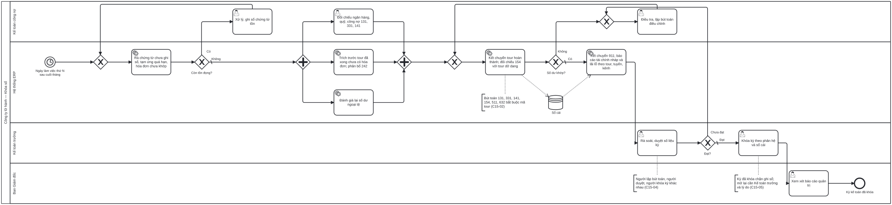

# BP-15 — Khóa sổ cuối kỳ và báo cáo (Record-to-Report)

> Sinh tự động từ `defs/bp15_khoa_so.py` bằng bpmn-kit — sửa định nghĩa rồi chạy lại, không sửa tay file này.

File BPMN 2.0: [`bpmn/BP-15-khoa-so-cuoi-ky.bpmn`](../bpmn/BP-15-khoa-so-cuoi-ky.bpmn) · Ảnh: [`png/BP-15-khoa-so-cuoi-ky.png`](../png/BP-15-khoa-so-cuoi-ky.png)

## 1. Thông tin chung

| Mục | Nội dung |
|---|---|
| Mục tiêu | Khóa sổ tháng trong số ngày mục tiêu, với lãi lỗ theo tour, tuyến, kênh lấy thẳng từ sổ cái (không tổng hợp Excel); kỳ đã khóa không ai ghi thêm được. |
| Sự kiện kích hoạt | Ngày làm việc thứ N sau cuối tháng. |
| Kết quả đầu ra | Kỳ kế toán đã khóa theo phân hệ và sổ cái; báo cáo tài chính nháp và báo cáo quản trị đã duyệt. |
| Phạm vi | Rà chứng từ tồn, đối chiếu ngân hàng/quỹ/công nợ, trích trước, phân bổ, đánh giá ngoại tệ, kết chuyển giá vốn và doanh thu tour hoàn thành, kiểm tra 154, kết chuyển 911, báo cáo, duyệt, khóa kỳ. |
| Ngoài phạm vi | Quyết toán thuế năm; hợp nhất báo cáo nhiều pháp nhân; lập ngân sách. |
| Module ERP | Sổ cái (GL); Công nợ (AR, AP); Tiền (CB); Giá thành theo tour (COST); Báo cáo quản trị |
| Quy trình chuẩn ERP tương ứng | Record-to-Report / month-end close: phân hệ khóa trước, sổ cái sau; đối chiếu sổ chi tiết với sổ cái; kết chuyển; báo cáo; khóa kỳ. |
| Quy trình đầu vào | Mọi quy trình phát sinh bút toán: [BP-10](BP-10-quyet-toan-dong-ho-so-tour.md), [BP-11](BP-11-thu-tien-cong-no-phai-thu.md), [BP-12](BP-12-thanh-toan-ncc-cong-no-phai-tra.md), [BP-16](BP-16-hdv-cong-tac-chi-tra-thu-lao.md) |
| Quy trình tiếp theo | Báo cáo tài chính, báo cáo quản trị; số liệu thực tế cho [BP-04](BP-04-hoach-dinh-mua-vu-lich-khoi-hanh.md) |

## 2. Vai trò (làn)

| Làn | Vai trò | Trách nhiệm trong quy trình |
|---|---|---|
| `ACC` | Kế toán công nợ | Xử lý chứng từ tồn; đối chiếu ngân hàng, quỹ, công nợ; điều tra và lập bút toán điều chỉnh. |
| `SYS` | Hệ thống ERP | Rà chứng từ tồn; trích trước, phân bổ; đánh giá ngoại tệ; kết chuyển; lập báo cáo. |
| `CHIEF_ACC` | Kế toán trưởng | Rà soát, duyệt số liệu; khóa kỳ. |
| `DIR` | Ban Giám đốc | Xem xét báo cáo quản trị. |

## 3. Các bước

| # | ID | Bước | Làn | Loại | Mô tả | Chứng từ / trạng thái | Kiểm soát |
|---|---|---|---|---|---|---|---|
| 1 | `S1` | Ngày làm việc thứ N sau cuối tháng | Hệ thống ERP | Sự kiện bắt đầu (hẹn giờ) |  |  |  |
| 2 | `T1` | Rà chứng từ chưa ghi sổ, tạm ứng quá hạn, hóa đơn chưa khớp | Hệ thống ERP | Hệ thống tự động |  |  |  |
| 3 | `G1` | Còn tồn đọng? | Hệ thống ERP | Rẽ nhánh (XOR) |  |  |  |
| 4 | `T2` | Xử lý, ghi sổ chứng từ tồn | Kế toán công nợ | Người dùng thao tác |  |  |  |
| 5 | `T3` | Đối chiếu ngân hàng, quỹ, công nợ 131, 331, 141 | Kế toán công nợ | Người dùng thao tác |  |  | C15-06 |
| 6 | `T5` | Trích trước tour đã xong chưa có hóa đơn; phân bổ 242 | Hệ thống ERP | Hệ thống tự động |  |  |  |
| 7 | `T6` | Đánh giá lại số dư ngoại tệ | Hệ thống ERP | Hệ thống tự động |  |  |  |
| 8 | `T7` | Kết chuyển tour hoàn thành; đối chiếu 154 với tour dở dang | Hệ thống ERP | Hệ thống tự động | Tour hoàn thành trong kỳ: Nợ 632 / Có 154, Nợ 3387 / Có 511 (nếu có). Số dư 154 phải bằng tổng chi phí của các tour chưa hoàn thành. |  | C15-02, C15-03 |
| 9 | `G2` | Số dư khớp? | Hệ thống ERP | Rẽ nhánh (XOR) |  |  |  |
| 10 | `T9` | Kết chuyển 911; báo cáo tài chính nháp và lãi lỗ theo tour, tuyến, kênh | Hệ thống ERP | Hệ thống tự động |  |  |  |
| 11 | `T8` | Điều tra, lập bút toán điều chỉnh | Kế toán công nợ | Người dùng thao tác |  | Bút toán điều chỉnh: DRAFT → PENDING |  |
| 12 | `T10` | Rà soát, duyệt số liệu kỳ | Kế toán trưởng | Người dùng thao tác |  |  | C15-04 |
| 13 | `G3` | Đạt? | Kế toán trưởng | Rẽ nhánh (XOR) |  |  |  |
| 14 | `T11` | Khóa kỳ theo phân hệ và sổ cái | Kế toán trưởng | Người dùng thao tác |  |  | C15-01, C15-05 |
| 15 | `T12` | Xem xét báo cáo quản trị | Ban Giám đốc | Người dùng thao tác |  |  |  |
| 16 | `E1` | Kỳ kế toán đã khóa | Ban Giám đốc | Sự kiện kết thúc |  |  |  |

## 4. Điểm quyết định

| Cổng | Câu hỏi / điều kiện | Nhánh → bước tiếp theo |
|---|---|---|
| `G1` | Còn tồn đọng? | Có → `T2` Xử lý, ghi sổ chứng từ tồn Không (mặc định) → `P1`  |
| `G2` | Số dư khớp? | Không → `T8` Điều tra, lập bút toán điều chỉnh Có (mặc định) → `T9` Kết chuyển 911; báo cáo tài chính nháp và lãi lỗ theo tour, tuyến, kênh |
| `G3` | Đạt? | Chưa đạt → `T8` Điều tra, lập bút toán điều chỉnh Đạt (mặc định) → `T11` Khóa kỳ theo phân hệ và sổ cái |

## 6. Kiểm soát nội bộ

| Mã | Kiểm soát | Loại | Nguồn |
|---|---|---|---|
| C15-01 | Khóa theo thứ tự: phân hệ (bán, mua, tiền, tạm ứng) trước, sổ cái sau; chứng từ tồn phải xử lý trước khi khóa. | Cấu hình | erp-ba-core r2r §5 |
| C15-02 | Chiều phân tích "mã tour" bắt buộc trên 131, 331, 141, 154, 335, 511, 632 — lãi lỗ theo tour lấy thẳng từ sổ. | Phòng ngừa · Cấu hình | erp-ba-core r2r §7 BR-GL-04, PRM-GL-011 |
| C15-03 | Cuối kỳ, 154 chỉ còn chi phí của tour chưa hoàn thành; tour đã hoàn thành phải kết chuyển giá vốn cùng kỳ với doanh thu. | Báo cáo (đối chiếu) | erp-ba-core costing §7.3 |
| C15-04 | Người lập bút toán điều chỉnh, người duyệt và người khóa kỳ là ba người khác nhau. | Phân quyền (SoD) | erp-ba-core r2r §10 |
| C15-05 | Kỳ đã khóa chặn ghi sổ, sửa, xóa; mở lại cần Kế toán trưởng, ghi lý do, lưu vết. | Phòng ngừa · Có sẵn | Elbardan ch07, ch08 (processing constraints) |
| C15-06 | Báo cáo đối chiếu (ngân hàng, công nợ, sổ chi tiết với sổ cái) lưu kèm kỳ khóa. | Báo cáo | erp-ba-core r2r §7 BR-GL-07 |

## 7. Chứng từ & trạng thái

| Chứng từ | Trạng thái chuẩn | Ghi chú |
|---|---|---|
| Bút toán điều chỉnh | DRAFT → PENDING → APPROVED → POSTED |  |
| Kỳ kế toán | Mở → khóa từng phân hệ → khóa sổ cái |  |
| Báo cáo tài chính nháp, báo cáo quản trị | DRAFT → APPROVED | Lãi lỗ theo tour, tuyến, kênh, thị trường. |

## 8. Bút toán phát sinh

| Nghiệp vụ | Nợ | Có | Ghi chú |
|---|---|---|---|
| Trích trước chi phí tour đã hoàn thành chưa có hóa đơn | 154 (mã tour) | 335 |  |
| Kết chuyển giá vốn tour hoàn thành | 632 | 154 |  |
| Doanh thu chờ phân bổ của tour hoàn thành | 3387 | 511 |  |
| Đánh giá lại số dư ngoại tệ | 515 / 635 |  | Thư viện erp-ba-core chưa thống nhất 413 hay ghi thẳng 515/635 theo TT99 — Kế toán xác nhận. |
| Kết chuyển cuối kỳ | 511, 515, 711 → 911; 911 → 632, 641, 642, 635, 811 |  | 911 → 4212. |

## 9. Tham số hệ thống gợi ý

| Tham số | Ý nghĩa | Mặc định gợi ý |
|---|---|---|
| Ngày bắt đầu khóa sổ | Ngày làm việc thứ N sau cuối tháng | N = 3 |
| Tài khoản bắt buộc mã tour | Danh sách | 131, 331, 141, 154, 335, 511, 632 |
| Ngưỡng bút toán điều chỉnh cần Giám đốc duyệt | Số tiền | Doanh nghiệp quy định |

## 10. Chỉ số đo (KPI)

| Chỉ số | Cách tính | Mục tiêu gợi ý |
|---|---|---|
| Số ngày khóa sổ | Từ cuối tháng tới khóa sổ cái | ≤ 5 ngày làm việc |
| Số bút toán điều chỉnh sau khóa | Theo kỳ | 0 |
| Tỷ lệ tour hoàn thành có lãi lỗ thực tế khi khóa kỳ | Tour đã kết chuyển / tour hoàn thành | 100% |

## 11. Căn cứ từ sách

- **O'Leary, ch07** ([nguồn](../../../books/oleary-erp-systems-lifecycle/chapters/ch07-deciding-to-go-erp.md)) — Mục tiêu đo được làm tiêu chí nghiệm thu, ví dụ rút ngắn đóng sổ từ 24 xuống 6 ngày.
- **O'Leary, ch10** ([nguồn](../../../books/oleary-erp-systems-lifecycle/chapters/ch10-choosing-standard-maps.md)) — Month-end close là một quy trình chuẩn (MAP) dùng chung toàn doanh nghiệp.
- **Parthasarathy, ch03** ([nguồn](../../../books/parthasarathy-erp-fundamentals/chapters/ch03-erp-modules.md)) — Finance: Accounting, Cost controlling, Planning & forecasting.
- **Elbardan & Kholeif, ch07** ([nguồn](../../../books/elbardan-erp-governance-audit/chapters/ch07-case-study-2-national-company.md)) — Nghiệp vụ phi tài chính tự sinh bút toán; hệ thống tài khoản chuẩn.
- **Elbardan & Kholeif, ch08** ([nguồn](../../../books/elbardan-erp-governance-audit/chapters/ch08-case-study-3-national-bank.md)) — Ràng buộc xử lý: chặn ghi sổ vào kỳ đã khóa.
- **erp-ba-core `r2r-general-ledger.md` §5, §7, §8, §10** — các bước đóng kỳ, chiều phân tích bắt buộc, SoD.

## 12. Điểm cần xác nhận với doanh nghiệp

- Doanh nghiệp theo TT99 hay chế độ kế toán doanh nghiệp nhỏ và vừa?
- Đánh giá lại ngoại tệ cuối kỳ ghi qua 413 hay thẳng 515/635?
- Mục tiêu số ngày khóa sổ là bao nhiêu?
