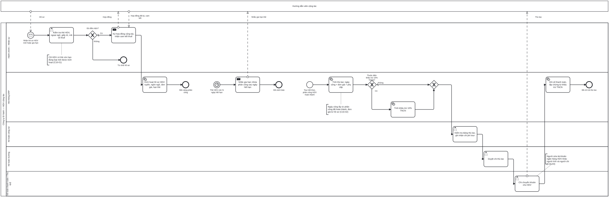

# BP-16 — Hướng dẫn viên cộng tác: hồ sơ, hạn thẻ và chi trả thù lao

> Sinh tự động từ `defs/bp16_hdv_cong_tac.py` bằng bpmn-kit — sửa định nghĩa rồi chạy lại, không sửa tay file này.

File BPMN 2.0: [`bpmn/BP-16-hdv-cong-tac-chi-tra-thu-lao.bpmn`](../bpmn/BP-16-hdv-cong-tac-chi-tra-thu-lao.bpmn) · Ảnh: [`png/BP-16-hdv-cong-tac-chi-tra-thu-lao.png`](../png/BP-16-hdv-cong-tac-chi-tra-thu-lao.png)

## 1. Thông tin chung

| Mục | Nội dung |
|---|---|
| Mục tiêu | Chỉ phân công HDV có thẻ còn hạn đúng loại; thù lao tính từ ngày công thực tế và đơn giá đã duyệt, ghi vào chi phí của đúng tour trước khi quyết toán, khấu trừ thuế TNCN đúng quy định và chi qua ngân hàng. |
| Sự kiện kích hoạt | Luồng 1: nhận hồ sơ HDV mới hoặc gia hạn. Luồng 2: thẻ HDV sắp hết hạn. Luồng 3: tour kết thúc, phân công HDV hoàn thành. |
| Kết quả đầu ra | Hồ sơ HDV đang dùng với hạn thẻ, ngôn ngữ, tuyến, đơn giá; thù lao đã ghi nhận vào chi phí tour, đã khấu trừ thuế, đã chi. |
| Phạm vi | HDV cộng tác (không ký hợp đồng lao động). Kiểm tra thẻ và giấy tờ, hợp đồng cộng tác, cảnh báo hạn thẻ, tính thù lao, khấu trừ TNCN, duyệt, chi trả, chứng từ khấu trừ thuế. |
| Ngoài phạm vi | HDV là nhân viên chính thức (tính lương theo quy trình nhân sự – tiền lương); phân công cho từng tour ([BP-08](BP-08-dat-dich-vu-chuan-bi-doan.md)). |
| Module ERP | Nhân sự – cộng tác viên (HR); Điều hành – phân công; Công nợ / Tiền (AP, CB); Thuế TNCN |
| Quy trình chuẩn ERP tương ứng | Quản lý nhân sự và chi trả cho cộng tác viên: hồ sơ (master data) → ghi nhận công → tính thù lao và khấu trừ → duyệt → chi. |
| Quy trình đầu vào | [BP-01](BP-01-quan-ly-du-lieu-goc.md) danh mục HDV; [BP-08](BP-08-dat-dich-vu-chuan-bi-doan.md) phân công; [BP-09](BP-09-thuc-hien-tour-xu-ly-su-co.md) ngày công thực tế |
| Quy trình tiếp theo | [BP-10](BP-10-quyet-toan-dong-ho-so-tour.md) chi phí HDV vào quyết toán tour; [BP-15](BP-15-khoa-so-cuoi-ky.md) khóa sổ |

## 2. Vai trò (làn)

| Làn | Vai trò | Trách nhiệm trong quy trình |
|---|---|---|
| `HR` | Hành chính – Nhân sự | Kiểm tra hồ sơ, thẻ HDV, ký hợp đồng cộng tác, nhận cam kết thuế. |
| `SYS` | Hệ thống ERP | Kích hoạt hồ sơ; cảnh báo hạn thẻ và khóa phân công; tính thù lao và khấu trừ; ghi sổ, lập chứng từ khấu trừ. |
| `ACC` | Kế toán công nợ | Kiểm tra bảng thù lao, ghi nhận chi phí tour. |
| `CHIEF_ACC` | Kế toán trưởng | Duyệt chi thù lao. |
| `CASH` | Kế toán thanh toán / Thủ quỹ | Chi chuyển khoản cho HDV. |

Bên ngoài (pool hộp đen, trao đổi bằng luồng thông điệp): **Hướng dẫn viên cộng tác**.

## 3. Các bước

| # | ID | Bước | Làn | Loại | Mô tả | Chứng từ / trạng thái | Kiểm soát |
|---|---|---|---|---|---|---|---|
| 1 | `S1` | Nhận hồ sơ HDV mới hoặc gia hạn | Hành chính – Nhân sự | Sự kiện bắt đầu (thông điệp) |  |  |  |
| 2 | `T1` | Kiểm tra thẻ HDV, ngoại ngữ, giấy tờ, mã số thuế | Hành chính – Nhân sự | Người dùng thao tác |  |  | C16-01 |
| 3 | `G1` | Đủ điều kiện? | Hành chính – Nhân sự | Rẽ nhánh (XOR) |  |  |  |
| 4 | `T2` | Ký hợp đồng cộng tác, nhận cam kết thuế | Hành chính – Nhân sự | Gửi thông điệp |  |  |  |
| 5 | `E1` | Từ chối hồ sơ | Hành chính – Nhân sự | Sự kiện kết thúc |  |  |  |
| 6 | `T3` | Kích hoạt hồ sơ HDV: tuyến, ngôn ngữ, đơn giá, hạn thẻ | Hệ thống ERP | Hệ thống tự động |  | Hồ sơ HDV: ACTIVE |  |
| 7 | `E2` | Sẵn sàng phân công | Hệ thống ERP | Sự kiện kết thúc |  |  |  |
| 8 | `S3` | Thẻ HDV còn N ngày hết hạn | Hệ thống ERP | Sự kiện bắt đầu (hẹn giờ) |  |  |  |
| 9 | `T9` | Nhắc gia hạn; khóa phân công sau ngày hết hạn | Hệ thống ERP | Gửi thông điệp |  | Hồ sơ HDV: LOCKED sau ngày hết hạn |  |
| 10 | `E4` | Đã cảnh báo | Hệ thống ERP | Sự kiện kết thúc |  |  |  |
| 11 | `S2` | Tour kết thúc, phân công HDV hoàn thành | Hệ thống ERP | Sự kiện bắt đầu |  |  |  |
| 12 | `T4` | Tính thù lao: ngày công × đơn giá + phụ cấp | Hệ thống ERP | Hệ thống tự động |  |  | C16-02 |
| 13 | `G2` | Thuộc diện khấu trừ 10% TNCN? | Hệ thống ERP | Rẽ nhánh (XOR) |  |  |  |
| 14 | `T5` | Tính khấu trừ 10% TNCN | Hệ thống ERP | Hệ thống tự động |  |  | C16-03 |
| 15 | `T6` | Kiểm tra bảng thù lao, ghi nhận chi phí tour | Kế toán công nợ | Người dùng thao tác | Ghi trước khi đóng hồ sơ tour (BP-10); cấn trừ tạm ứng còn lại của HDV nếu có. | Bảng thù lao: PENDING | C16-05 |
| 16 | `T7` | Duyệt chi thù lao | Kế toán trưởng | Người dùng thao tác |  | Bảng thù lao: APPROVED | C16-04 |
| 17 | `T8` | Chi chuyển khoản cho HDV | Kế toán thanh toán / Thủ quỹ | Người dùng thao tác |  |  |  |
| 18 | `T10` | Ghi sổ thanh toán, lập chứng từ khấu trừ TNCN | Hệ thống ERP | Hệ thống tự động |  | Bảng thù lao: POSTED |  |
| 19 | `E3` | Đã chi trả thù lao | Hệ thống ERP | Sự kiện kết thúc |  |  |  |

## 4. Điểm quyết định

| Cổng | Câu hỏi / điều kiện | Nhánh → bước tiếp theo |
|---|---|---|
| `G1` | Đủ điều kiện? | Không → `E1` Từ chối hồ sơ Có (mặc định) → `T2` Ký hợp đồng cộng tác, nhận cam kết thuế |
| `G2` | Thuộc diện khấu trừ 10% TNCN? | Có → `T5` Tính khấu trừ 10% TNCN Không (mặc định) → `T6` Kiểm tra bảng thù lao, ghi nhận chi phí tour |

## 5. Trao đổi với bên ngoài

| Từ | Đến | Thông điệp |
|---|---|---|
| Hướng dẫn viên cộng tác | `S1` Nhận hồ sơ HDV mới hoặc gia hạn | Hồ sơ |
| `T2` Ký hợp đồng cộng tác, nhận cam kết thuế | Hướng dẫn viên cộng tác | Hợp đồng |
| Hướng dẫn viên cộng tác | `T2` Ký hợp đồng cộng tác, nhận cam kết thuế | Hợp đồng đã ký, cam kết |
| `T9` Nhắc gia hạn; khóa phân công sau ngày hết hạn | Hướng dẫn viên cộng tác | Nhắc gia hạn thẻ |
| `T8` Chi chuyển khoản cho HDV | Hướng dẫn viên cộng tác | Thù lao |

## 6. Kiểm soát nội bộ

| Mã | Kiểm soát | Loại | Nguồn |
|---|---|---|---|
| C16-01 | Chỉ kích hoạt và phân công HDV có thẻ còn hạn đúng loại (nội địa, quốc tế, tại điểm); khóa phân công sau ngày hết hạn. | Phòng ngừa · Cấu hình | Elbardan ch07 |
| C16-02 | Ngày công lấy từ phân công đã hoàn thành; đơn giá từ hồ sơ HDV/hợp đồng đã duyệt; không nhập tay. | Cấu hình | O'Leary ch04 (enter once) |
| C16-03 | Khấu trừ TNCN 10% tự động khi thuộc diện (cá nhân không ký HĐLĐ, mỗi lần chi từ ngưỡng trở lên, không có cam kết hợp lệ). | Cấu hình | erp-ba-core hr-payroll §7 BR-PAY-10 |
| C16-04 | Người tạo/sửa hồ sơ và tài khoản ngân hàng HDV khác người tính thù lao và khác người chi tiền. | Phân quyền (SoD) | erp-ba-core ap §10 |
| C16-05 | Thù lao phải ghi nhận vào chi phí tour trước khi đóng hồ sơ tour; cấn trừ tạm ứng còn lại. | Phòng ngừa | erp-ba-core project-management §7 BR-PRJ-10 |

## 7. Chứng từ & trạng thái

| Chứng từ | Trạng thái chuẩn | Ghi chú |
|---|---|---|
| Hồ sơ HDV | ACTIVE / INACTIVE / LOCKED | Thẻ HDV (loại, số, hạn), ngôn ngữ, tuyến, đơn giá, tài khoản ngân hàng. |
| Hợp đồng cộng tác | DRAFT → APPROVED → CLOSED | Kèm cam kết thuế nếu có. |
| Bảng thù lao | DRAFT → PENDING → APPROVED → POSTED | Theo HDV và mã tour. |
| Chứng từ khấu trừ thuế TNCN | Phát hành điện tử | Cấp cho HDV theo lần chi hoặc theo năm. |

## 8. Bút toán phát sinh

| Nghiệp vụ | Nợ | Có | Ghi chú |
|---|---|---|---|
| Ghi nhận thù lao vào chi phí tour | 154 (mã tour) | 3388 hoặc 334 | Doanh nghiệp thống nhất tài khoản cho cộng tác viên. |
| Khấu trừ TNCN | 3388 hoặc 334 | 3335 |  |
| Chi thù lao | 3388 hoặc 334 | 112 |  |

## 9. Tham số hệ thống gợi ý

| Tham số | Ý nghĩa | Mặc định gợi ý |
|---|---|---|
| Ngưỡng khấu trừ TNCN mỗi lần chi | Áp cho cá nhân không ký HĐLĐ | 2.000.000 đ (xác nhận lại quy định hiện hành) |
| Thuế suất khấu trừ |  | 10% |
| Cảnh báo hạn thẻ HDV | Số ngày trước khi hết hạn | 60 ngày |
| Kỳ chi thù lao | Theo tour hoặc gộp kỳ | Doanh nghiệp quy định |

## 10. Chỉ số đo (KPI)

| Chỉ số | Cách tính | Mục tiêu gợi ý |
|---|---|---|
| Số phân công HDV thẻ hết hạn | Phát hiện khi kiểm tra | 0 |
| Thời gian từ kết thúc tour tới chi thù lao | Bình quân | Doanh nghiệp quy định |
| Tỷ lệ thù lao ghi nhận trước khi đóng tour | Bảng thù lao ghi trước đóng / tổng | 100% |

## 11. Căn cứ từ sách

- **Parthasarathy, ch03** ([nguồn](../../../books/parthasarathy-erp-fundamentals/chapters/ch03-erp-modules.md)) — Module HR: Employment, Compensation.
- **O'Leary, ch04** ([nguồn](../../../books/oleary-erp-systems-lifecycle/chapters/ch04-erp-data-input.md)) — Ghi dữ liệu tại nguồn (phân công) thay vì nhập lại khi tính tiền.
- **Elbardan & Kholeif, ch08** ([nguồn](../../../books/elbardan-erp-governance-audit/chapters/ch08-case-study-3-national-bank.md)) — RBAC hai lớp; giám sát thay đổi quyền và dữ liệu nhạy cảm.
- **erp-ba-core `hr-payroll.md` §7 BR-PAY-10** — khấu trừ 10% TNCN cho cá nhân không ký HĐLĐ.

## 12. Điểm cần xác nhận với doanh nghiệp

- HDV cộng tác hạch toán qua 334 hay 3388?
- Thù lao chi theo từng tour hay gộp theo tháng?
- Ngưỡng khấu trừ TNCN đang áp dụng là bao nhiêu (đã có đề xuất nâng ngưỡng — cần kế toán xác nhận)?
