# TÀI LIỆU ĐẶC TẢ YÊU CẦU (RSD)

## Quy trình BP-13: Thay đổi, hủy booking và hoàn tiền

| Thông tin | Nội dung |
|---|---|
| Mã tài liệu | RSD-BP-13 |
| Trạng thái | Bản nháp |
| Ngày cập nhật | 20/10/2026 |
| Phạm vi | Bán hàng (booking), Điều hành (dịch vụ nhà cung cấp), Công nợ phải thu, Hóa đơn điện tử, Tiền |
| Người soạn | BA dự án |
| Người duyệt | Trưởng phòng Kinh doanh, Trưởng Điều hành, Kế toán trưởng |
| Tài liệu liên quan | Mô tả quy trình BP-13 và sơ đồ BPMN; các quy trình BP-05, 06, 07, 08, 09, 11, 12, 14 |

**Phiên bản**

| Version | Lý do | Date | Người sửa | Mô tả |
|---|---|---|---|---|
| 0.1 | Thêm mới | 20/10/2026 | BA | Khởi tạo tài liệu từ mô tả quy trình BP-13 |
| 0.2 | Cập nhật | 20/10/2026 | BA | Viết lại cho người đọc nghiệp vụ; bổ sung 11 sơ đồ; trình bày theo khung RSD của team BA |

**Nội dung tài liệu**

1. Mô tả chung
2. Mô tả các bước thực hiện
3. Input / Output
4. Phân quyền thực hiện
5. Tham số hệ thống
6. Flow Diagrams
7. Kiểm soát nội bộ
8. Yêu cầu phi chức năng
9. Tiêu chí nghiệm thu
10. Câu hỏi cần doanh nghiệp xác nhận
11. Tài liệu tham khảo

---

## Cách đọc tài liệu

**Mã tham chiếu.** Mỗi loại nội dung có một mã riêng để tiện trao đổi và truy vết:

| Mã | Loại nội dung | Ví dụ |
|---|---|---|
| Bước 1 … 15 | Các bước của quy trình (mục 2) | Bước 5 – Tính phí hủy |
| QT-01 … | Quy tắc nghiệp vụ | QT-07 Phí hủy do hệ thống tính |
| TS-01 … | Tham số hệ thống (giá trị cấu hình được) | TS-01 Bảng phí hủy |
| KS-01 … | Điểm kiểm soát nội bộ | KS-02 Giảm phí phải được duyệt |
| TN-01 … | Nguyên tắc tách nhiệm vụ | TN-01 Người đề nghị không tự duyệt |
| BC-01 … | Báo cáo | BC-03 Báo cáo ngoại lệ |
| NT-01 … | Tiêu chí nghiệm thu | NT-01 Tính phí hủy đúng mốc |
| CH-01 … | Câu hỏi cần doanh nghiệp xác nhận | CH-01 Bảng phí hủy |

**Nhãn đánh dấu:**

- **[Cần xác nhận: CH-xx]** — thông tin chưa có, cần doanh nghiệp trả lời câu hỏi CH-xx.
- **[Đề xuất: CH-xx]** — BA đề xuất theo thông lệ ERP, chưa có trong mô tả quy trình gốc; doanh nghiệp quyết định giữ hay bỏ.

**Ký hiệu trong bảng phân quyền:**

- **✔** — được phép.
- **—** — không được phép.

---

## 1. Mô tả chung

| Đặc tả use case | Nội dung |
|---|---|
| Tên | Thay đổi, hủy booking và hoàn tiền |
| Mã | BP-13 |
| Mô tả | Là nhân viên Kinh doanh, tôi muốn xử lý mọi yêu cầu đổi, hủy booking hoặc đền bù của khách qua một phiếu yêu cầu thay đổi, để phí hủy và chênh lệch được hệ thống tính đúng hợp đồng, nhà cung cấp được báo sửa/hủy kịp thời, hóa đơn và tiền hoàn được điều chỉnh có duyệt, và khách nhận xác nhận rõ ràng |
| Tác nhân | Chủ động: Kinh doanh, Trưởng phòng Kinh doanh, Ban Giám đốc, Điều hành, Kế toán công nợ, Kế toán trưởng, Chăm sóc khách hàng. Thụ động: Hệ thống ERP; Khách hàng, Đại lý, OTA; Nhà cung cấp dịch vụ; Ngân hàng, Cổng thanh toán; Cơ quan thuế |
| Mức độ ưu tiên | High |
| Điều kiện kích hoạt | Khách yêu cầu đổi hoặc hủy; hoặc chuyển sang từ BP-07 (hủy chuyến), BP-09 (sự cố trong tour), BP-11 (quá hạn thanh toán), BP-14 (khiếu nại), BP-06 (tour riêng không cọc) — mục 1.4 |
| Tiền điều kiện | Booking đã giữ chỗ hoặc đã xác nhận; chưa có phiếu đang xử lý; hợp đồng có bảng phí hủy — mục 1.6 |
| Hậu điều kiện | Booking có phiên bản mới hoặc đã hủy; dịch vụ NCC đã sửa/hủy; hóa đơn và tiền đã điều chỉnh; khách nhận xác nhận cuối — mục 1.6 |

### 1.1 Mục đích

Quy trình này quản lý mọi thay đổi trên một booking đã xác nhận với khách. Các thay đổi gồm: đổi ngày, đổi số khách, đổi hạng phòng, đổi dịch vụ, hủy một phần, hủy toàn bộ, và đền bù bằng tiền sau khiếu nại.

Mỗi thay đổi đều đi qua **một phiếu yêu cầu thay đổi** trên hệ thống và phải đảm bảo:

1. **Có xác nhận của khách.** Hệ thống lưu lại booking trước và sau khi thay đổi.
2. **Hệ thống tự tính phí hủy và chênh lệch giá** theo chính sách trong hợp đồng; người dùng không nhập tay.
3. **Giảm phí ngoài chính sách phải được người khác duyệt.** Người đề nghị không được tự duyệt.
4. **Mọi dịch vụ đã đặt với nhà cung cấp (NCC) đều được báo sửa hoặc hủy kịp thời**, để công ty không bị NCC tính tiền oan.
5. **Hóa đơn đã phát hành chỉ được xử lý bằng hóa đơn điều chỉnh hoặc thay thế**, luôn có Kế toán trưởng duyệt.
6. **Tiền chỉ hoàn về đúng tài khoản đã trả.** Người lập yêu cầu, người duyệt hoàn tiền và người chi tiền là ba người khác nhau.

Theo cách gọi của ERP, đây là quy trình **quản lý thay đổi đơn hàng (change order)**: đơn đã duyệt không được sửa đè mà phải tạo phiên bản thay đổi có duyệt. Các mốc ngày trước khởi hành đóng vai trò như **"vùng thời gian" (time fence)**, quyết định mức phí và ai được phép thay đổi.

### 1.2 Mục tiêu và chỉ số đo

| Mục tiêu | Cách đo | Chỉ tiêu đề xuất |
|---|---|---|
| Xử lý nhanh yêu cầu của khách | Thời gian từ lúc nhận yêu cầu đến lúc gửi xác nhận cuối | Không quá 2 ngày làm việc |
| Giảm phí phạt NCC do báo hủy trễ | Tổng phí phạt NCC thực tế theo tháng | Giảm dần theo tháng |
| Hoàn tiền đúng hạn | Thời gian từ lúc duyệt hoàn tiền đến lúc tiền về khách | Không quá 7 ngày làm việc |
| Không thay đổi booking ngoài hệ thống | Số booking bị đổi giá, đổi số khách hoặc đổi chuyến mà không có phiếu yêu cầu | Bằng 0 |

### 1.3 Phạm vi

**Trong phạm vi**

- Ghi nhận yêu cầu đổi/hủy và bằng chứng khách xác nhận.
- Đổi ngày khởi hành, số khách, hạng phòng, dịch vụ; đổi tên người đi.
- Hủy một phần hoặc toàn bộ booking; tính phí hủy; duyệt giảm phí.
- Đền bù bằng tiền đã được duyệt ở quy trình khiếu nại (BP-14).
- Báo NCC sửa/hủy dịch vụ; ghi nhận phí phạt NCC.
- Cập nhật booking (lưu phiên bản), số chỗ, dự toán chi phí, lịch thu tiền.
- Lập hóa đơn điện tử điều chỉnh hoặc thay thế.
- Hoàn tiền cho khách.
- Nhắc hạn và cảnh báo khi quá hạn.
- Báo cáo theo dõi và báo cáo kiểm soát.

**Ngoài phạm vi**

| Nội dung | Quy trình đảm nhận |
|---|---|
| Thu thêm tiền khi giá trị booking tăng (quy trình này chỉ cập nhật lịch thu) | BP-11 Thu tiền và công nợ phải thu |
| Lập hóa đơn lần đầu, kể cả cho dịch vụ mới phát sinh chưa từng xuất hóa đơn | BP-11 |
| Giải quyết khiếu nại, quyết định mức đền bù | BP-14 Chăm sóc khách hàng và khiếu nại |
| Thanh toán phí phạt cho NCC | BP-12 Thanh toán NCC |
| Quyết định hủy hoặc gộp chuyến | BP-07 Chốt chuyến |
| Sửa booking chưa xác nhận | BP-05, BP-06 (sửa trực tiếp trên booking) |
| Khách vắng mặt khi tour đã khởi hành | BP-09 Thực hiện tour |

### 1.4 Khi nào quy trình bắt đầu

Ngoài trường hợp khách chủ động yêu cầu, quy trình còn được kích hoạt từ 5 quy trình khác. Mỗi tình huống có người lập phiếu và loại bằng chứng riêng.

| Tình huống | Người lập phiếu | Bằng chứng bắt buộc | Điểm khác biệt |
|---|---|---|---|
| Khách, đại lý hoặc OTA yêu cầu đổi/hủy | Nhân viên Kinh doanh | Email, tin nhắn hoặc văn bản của khách, có ghi thời điểm | Luồng chuẩn |
| Công ty hủy hoặc gộp chuyến (từ BP-07) | Trưởng phòng Kinh doanh; hoặc hệ thống tự lập cho mọi booking của chuyến [Đề xuất: CH-12] | Quyết định hủy/gộp chuyến | Khách không chịu phí hủy; được chọn chuyển chuyến hoặc hoàn tiền |
| Sự cố trong tour làm đổi dịch vụ đã bán (từ BP-09) | Điều hành | Xác nhận của khách do hướng dẫn viên ghi nhận | Không tính phí hủy; thu thêm hoặc hoàn phần chênh lệch |
| Khách quá hạn thanh toán, không được gia hạn (từ BP-11) | Nhân viên Kinh doanh | Lịch sử nhắc nợ, thông báo hủy đã gửi khách | Không cần khách đồng ý; tính phí theo hợp đồng |
| Tour thiết kế riêng không nhận đủ cọc (từ BP-06) | Kế toán công nợ | Đề nghị đặt cọc đã gửi, hạn cọc đã qua | Hủy theo chính sách; thường chưa thu tiền nên không phải hoàn |
| Đền bù bằng tiền sau khiếu nại (từ BP-14) | Chăm sóc khách hàng | Quyết định đền bù đã duyệt | Không đổi dịch vụ, không báo NCC; số tiền lấy từ BP-14 |

### 1.5 Các loại yêu cầu

| Loại | Ví dụ | Hệ thống xử lý theo nhánh |
|---|---|---|
| Thay đổi | Đổi sang chuyến khác cùng tour; thêm khách; nâng hạng phòng; thêm/bớt dịch vụ tự chọn; đổi tên người đi | Nhánh **Đổi** (Bước 4) |
| Hủy một phần | Bớt 1 trong 4 khách; hủy một dịch vụ bán kèm | Nhánh **Hủy** (Bước 5) |
| Hủy toàn bộ | Khách hủy cả booking | Nhánh **Hủy** (Bước 5) |
| Đền bù | Hoàn một phần tiền tour do khiếu nại | Nhánh **Đổi** (Bước 4) |

> **Lưu ý:** Bớt số khách được xử lý như **hủy một phần**, vì phần khách bị bớt phải chịu phí hủy. Mỗi phiếu chỉ có một loại yêu cầu.

### 1.6 Điều kiện trước khi bắt đầu và kết quả sau khi hoàn tất

**Điều kiện trước**

1. Booking đang ở trạng thái *Giữ chỗ chờ cọc* hoặc *Đã xác nhận*. Riêng loại đền bù được lập cho booking đã *Hoàn thành* tour.
2. Booking chưa có phiếu yêu cầu thay đổi nào đang xử lý dở.
3. Hợp đồng của booking có đính kèm bảng phí hủy.
4. Hồ sơ tour chưa quyết toán xong và kỳ kế toán chưa khóa.

**Kết quả sau khi hoàn tất**

| Kết quả | Dữ liệu sau khi xong |
|---|---|
| Thay đổi hoặc hủy đã thực hiện | Phiếu yêu cầu: *Hoàn thành*. Booking có phiên bản mới, hoặc *Đã hủy*; phiên bản cũ được lưu lại để tra cứu. Đã cập nhật số chỗ, dự toán chi phí, lịch thu tiền. Dịch vụ NCC đã được xác nhận sửa/hủy. Phí phạt NCC đã ghi nhận công nợ phải trả. Hóa đơn điều chỉnh (nếu có) đã được cấp mã. Tiền (nếu có) đã hoàn. Khách đã nhận xác nhận cuối. |
| Khách không đồng ý hoặc không trả lời đúng hạn | Phiếu yêu cầu: *Từ chối*. Booking giữ nguyên. Chỗ giữ tạm đã được nhả. |
| Khách rút yêu cầu | Phiếu yêu cầu: *Đã hủy*. Không dữ liệu nào khác thay đổi. |

### 1.7 Các bên tham gia

| Bên tham gia | Vai trò trong quy trình |
|---|---|
| Nhân viên Kinh doanh | Tiếp nhận yêu cầu, lập phiếu, gửi phương án, ghi phản hồi của khách, gửi xác nhận cuối |
| Trưởng phòng Kinh doanh | Duyệt giảm phí hủy trong hạn mức; lập phiếu khi công ty hủy chuyến |
| Ban Giám đốc | Duyệt giảm phí và hoàn tiền vượt hạn mức; duyệt bảng phí hủy [Đề xuất: CH-04, CH-17] |
| Điều hành | Báo NCC sửa/hủy dịch vụ, ghi phí phạt; lập phiếu khi có sự cố trong tour |
| Trưởng Điều hành | Xử lý khi NCC quá hạn hoặc từ chối [Đề xuất: CH-23] |
| Kế toán công nợ | Lập hóa đơn điều chỉnh/thay thế; lập lệnh chi hoàn tiền |
| Kế toán trưởng | Duyệt và ký số hóa đơn; duyệt hoàn tiền |
| Chăm sóc khách hàng | Lập phiếu đền bù từ quy trình khiếu nại |
| Kiểm soát nội bộ | Chỉ xem dữ liệu, chạy báo cáo kiểm soát [Đề xuất: CH-23] |
| Hệ thống ERP | Tự tính phí và chênh lệch, cập nhật dữ liệu, nhắc hạn |
| Bên ngoài | Khách hàng/đại lý/OTA; nhà cung cấp dịch vụ; ngân hàng/cổng thanh toán; cơ quan thuế |

Sơ đồ tổng quan các bên: xem **Hình 2** (mục 6).

### 1.8 Quy trình liên quan

| Quy trình | Quan hệ với BP-13 |
|---|---|
| BP-05, BP-06 Bán tour | Tạo booking, hợp đồng và bảng phí hủy đính kèm |
| BP-02 Hợp đồng NCC | Cung cấp điều khoản phạt khi sửa/hủy dịch vụ |
| BP-08 Đặt dịch vụ | Cung cấp danh sách dịch vụ đã đặt với NCC |
| BP-07, BP-09, BP-11, BP-14, BP-06 | Kích hoạt BP-13 (mục 1.4) |
| BP-11 Thu tiền | Nhận lịch thu mới để thu phần tăng thêm |
| BP-12 Thanh toán NCC | Nhận khoản phải trả phí phạt NCC |
| BP-10 Quyết toán tour | Nhận dự toán và chi phí đã cập nhật |

### 1.9 Thuật ngữ

| Thuật ngữ | Giải thích |
|---|---|
| Phiếu yêu cầu thay đổi | Chứng từ ghi nhận một yêu cầu đổi, hủy hoặc đền bù trên một booking |
| Phiên bản booking | Bản lưu đầy đủ của booking (khách, dịch vụ, giá, lịch thu) tại một thời điểm, đánh số 1, 2, 3… |
| Số ngày trước khởi hành | Số ngày từ ngày nhận yêu cầu đến ngày khởi hành; căn cứ để tra mức phí hủy |
| Phí hủy chuẩn | Phí hệ thống tính theo bảng phí hủy, trước khi giảm |
| Phí hủy khách chịu | Phí hủy chuẩn trừ phần giảm đã được duyệt |
| Phí phạt NCC | Khoản NCC tính cho công ty khi sửa/hủy dịch vụ, theo hợp đồng NCC |
| Đã thu | Tổng tiền khách đã trả cho booking, trừ các khoản đã hoàn trước đó |
| Tài khoản gốc | Tài khoản hoặc phương thức mà người trả tiền đã dùng để thanh toán |
| Giữ chỗ tạm | Chỗ được giữ trên chuyến mới trong lúc chờ khách đồng ý phương án |

---

## 2. Mô tả các bước thực hiện

### 2.1 Tổng quan

Quy trình gồm **15 bước, chia 4 giai đoạn**. Sơ đồ luồng xem **Hình 3** và **Hình 4** (mục 6).

| Giai đoạn | Các bước | Kết quả của giai đoạn |
|---|---|---|
| 1. Tiếp nhận và tính toán | Bước 1 – 5 | Có phiếu yêu cầu kèm xác nhận của khách; hệ thống đã tính phí hủy hoặc chênh lệch |
| 2. Chốt phương án | Bước 6 – 8 | Khách đồng ý phương án, hoặc mức giảm phí đã được duyệt |
| 3. Thực hiện | Bước 9 – 10 | NCC đã xác nhận sửa/hủy; booking, chỗ, dự toán, lịch thu đã cập nhật |
| 4. Tài chính và kết thúc | Bước 11 – 15 | Hóa đơn và tiền đã điều chỉnh; khách nhận xác nhận cuối |

### 2.2 Bảng tóm tắt các bước

| Bước | Tên bước | Người thực hiện | Áp dụng khi | Trạng thái phiếu sau bước |
|---|---|---|---|---|
| 1 | Tiếp nhận yêu cầu | Kinh doanh | Luôn luôn | — |
| 2 | Lập phiếu yêu cầu thay đổi | Kinh doanh (hoặc người lập theo mục 1.4) | Luôn luôn | Nháp |
| 3 | Phân loại yêu cầu | Hệ thống | Luôn luôn | Nháp |
| 4 | Kiểm tra chỗ, tính giá mới và chênh lệch | Hệ thống | Đổi, đền bù | Nháp |
| 5 | Tính phí hủy và phí phạt NCC dự kiến | Hệ thống | Hủy | Nháp |
| 6 | Gửi phương án cho khách | Kinh doanh | Đổi | Chờ khách xác nhận |
| 7 | Ghi nhận phản hồi của khách | Kinh doanh | Đổi | Đã duyệt / Từ chối |
| 8 | Duyệt giảm phí hủy | Trưởng phòng KD (hoặc Ban Giám đốc) | Hủy có đề nghị giảm phí | Đã duyệt / Trả lại |
| 9 | Báo NCC sửa/hủy dịch vụ, ghi phí phạt | Điều hành | Có dịch vụ đã đặt bị ảnh hưởng | Đang làm với NCC |
| 10 | Cập nhật booking và dữ liệu liên quan | Hệ thống | Luôn luôn | Hoàn thành |
| 11 | Lập hóa đơn điều chỉnh hoặc thay thế | Kế toán công nợ | Đã xuất hóa đơn cho phần thay đổi | — |
| 12 | Duyệt, ký số hóa đơn | Kế toán trưởng | Như bước 11 | — |
| 13 | Duyệt hoàn tiền | Kế toán trưởng (hoặc thêm Ban Giám đốc) | Khách đã trả nhiều hơn số phải thu mới | — |
| 14 | Lập lệnh chi hoàn tiền | Kế toán công nợ [Cần xác nhận: CH-09] | Như bước 13 | — |
| 15 | Gửi xác nhận cuối cho khách | Kinh doanh | Luôn luôn | Hoàn thành (đã xác nhận) |

### 2.3 Mô tả chi tiết từng bước

#### Bước 1 – Tiếp nhận yêu cầu

- **Người thực hiện:** Nhân viên Kinh doanh.
- **Mô tả:** Khách gửi yêu cầu qua email, điện thoại, cổng OTA hoặc trực tiếp. Yêu cầu cũng có thể được chuyển sang từ quy trình khác (mục 1.4).
- **Hệ thống:** Với kênh có kết nối (email, OTA), hệ thống tự lưu thời điểm nhận và nội dung gốc [Đề xuất: CH-15].

#### Bước 2 – Lập phiếu yêu cầu thay đổi

- **Người thực hiện:** Nhân viên Kinh doanh, hoặc người lập theo từng tình huống ở mục 1.4.
- **Việc cần làm:**
  - Mở booking, chọn **Tạo yêu cầu thay đổi**.
  - Chọn loại yêu cầu và nguồn yêu cầu; nhập thời điểm nhận yêu cầu.
  - Chọn khách hoặc dịch vụ bị đổi/hủy, và phương án mới nếu có (chuyến mới, hạng phòng, dịch vụ).
  - Đính kèm bằng chứng khách xác nhận.
  - Nếu là hủy và muốn giảm phí cho khách: nhập mức đề nghị giảm và lý do.
  - Bấm **Tính toán**.
- **Hệ thống tự động:**
  - Kiểm tra điều kiện lập phiếu.
  - Cấp số phiếu.
  - Khóa không cho sửa trực tiếp booking.
  - Lưu lại bản booking hiện tại để đối chiếu về sau.
- **Quy tắc áp dụng:** QT-01 đến QT-06.
- **Kết quả:** Phiếu ở trạng thái *Nháp*.

#### Bước 3 – Phân loại yêu cầu

- **Người thực hiện:** Hệ thống.
- **Mô tả:**
  - Loại *Hủy một phần* hoặc *Hủy toàn bộ*: đi nhánh **Hủy** (Bước 5).
  - Loại *Thay đổi* hoặc *Đền bù*: đi nhánh **Đổi** (Bước 4).

#### Bước 4 – Kiểm tra chỗ, tính giá mới và chênh lệch (nhánh Đổi)

- **Người thực hiện:** Hệ thống.
- **Hệ thống tự động:**
  - Kiểm tra chuyến hoặc dịch vụ mới còn đủ chỗ.
  - Tính giá mới theo bảng giá hiện hành, cộng phí thay đổi (nếu có), rồi tính chênh lệch so với giá cũ.
  - Với loại đền bù: chênh lệch bằng âm số tiền đền bù đã duyệt ở BP-14.
- **Quy tắc áp dụng:** QT-14, QT-15, QT-17.
- **Kết quả:** Phiếu hiển thị giá cũ, giá mới, chênh lệch. Sơ đồ quyết định: **Hình 6**.

#### Bước 5 – Tính phí hủy và phí phạt NCC dự kiến (nhánh Hủy)

- **Người thực hiện:** Hệ thống.
- **Hệ thống tự động:**
  - Tính số ngày trước khởi hành.
  - Tra mức phí trong **bảng phí hủy đính kèm hợp đồng** của booking.
  - Tính phí hủy chuẩn.
  - Tính phí phạt NCC dự kiến theo hợp đồng NCC của từng dịch vụ đã đặt. Con số này chỉ để người duyệt tham khảo.
  - Nếu công ty hủy chuyến hoặc có sự cố trong tour: phí hủy bằng 0.
- **Quy tắc áp dụng:** QT-07 đến QT-10.
- **Kết quả:** Phiếu hiển thị phí hủy chuẩn. Sơ đồ quyết định: **Hình 5**.

#### Bước 6 – Gửi phương án cho khách (nhánh Đổi)

- **Người thực hiện:** Nhân viên Kinh doanh.
- **Việc cần làm:** Xem kết quả tính, bấm **Gửi phương án cho khách**.
- **Hệ thống tự động:**
  - Tạo văn bản phương án theo mẫu: chênh lệch, lịch thu tiền dự kiến, hạn trả lời. Gửi cho khách.
  - Giữ chỗ tạm trên chuyến mới.
  - Đặt hạn trả lời là 48 giờ (TS-06). Quá hạn mà khách chưa trả lời thì phiếu tự chuyển *Từ chối*.
- **Kết quả:** Phiếu ở trạng thái *Chờ khách xác nhận*.

#### Bước 7 – Ghi nhận phản hồi của khách (nhánh Đổi)

- **Người thực hiện:** Nhân viên Kinh doanh.
- **Việc cần làm:** Chọn **Khách đồng ý** hoặc **Khách không đồng ý**, đính kèm bằng chứng.
- **Kết quả:**
  - Đồng ý: phiếu chuyển *Đã duyệt*, sang Bước 9.
  - Không đồng ý: phiếu chuyển *Từ chối*. Booking giữ nguyên, chỗ tạm được nhả, quy trình kết thúc.
- **Quy tắc áp dụng:** QT-04, QT-16.

#### Bước 8 – Duyệt giảm phí hủy (nhánh Hủy có đề nghị giảm phí)

- **Người thực hiện:** Trưởng phòng Kinh doanh. Ban Giám đốc duyệt khi mức đề nghị vượt hạn mức, hoặc khi người lập phiếu chính là Trưởng phòng.
- **Việc cần làm:**
  - Xem phí hủy chuẩn, mức đề nghị giảm, lý do, phí phạt NCC dự kiến, lãi/lỗ dự kiến của tour.
  - Nhập mức giảm được duyệt (không vượt mức đề nghị) và ý kiến.
  - Bấm **Duyệt**, hoặc **Trả lại** để Kinh doanh bổ sung.
- **Kết quả:** Phiếu chuyển *Đã duyệt*, phí khách chịu = phí chuẩn − mức giảm được duyệt. Nếu Trả lại, phiếu chuyển *Trả lại để sửa*.
- **Lưu ý:** Hủy mà không đề nghị giảm phí thì bỏ qua bước này; phiếu chuyển thẳng *Đã duyệt* với phí chuẩn. Có cần báo trước mức phí cho khách trước khi thực hiện không: [Cần xác nhận: CH-06].
- **Quy tắc áp dụng:** QT-11 đến QT-13; TN-01.

#### Bước 9 – Báo NCC sửa/hủy dịch vụ, ghi phí phạt

- **Người thực hiện:** Điều hành.
- **Việc cần làm:**
  - Mở danh sách dịch vụ bị ảnh hưởng (hệ thống lập sẵn).
  - Gửi yêu cầu sửa/hủy cho từng NCC.
  - Ghi xác nhận của NCC và phí phạt thực tế, đính kèm văn bản của NCC.
- **Hệ thống tự động:**
  - Khi phiếu được duyệt, hệ thống lập danh sách **mọi** dịch vụ đã đặt thuộc phần bị đổi/hủy.
  - Theo dõi hạn gửi và hạn NCC trả lời; nhắc và báo Trưởng Điều hành khi quá hạn.
  - Không có dịch vụ nào bị ảnh hưởng thì bỏ qua bước này.
- **Quy tắc áp dụng:** QT-19 đến QT-22.
- **Kết quả:** Phiếu ở trạng thái *Đang làm với NCC*. Khi mọi dịch vụ đã có kết quả, hệ thống chuyển sang Bước 10.

#### Bước 10 – Cập nhật booking và dữ liệu liên quan

- **Người thực hiện:** Hệ thống.
- **Hệ thống tự động** (làm cùng một lúc; một việc lỗi thì hoàn lại tất cả):
  - Tạo phiên bản booking mới, hoặc chuyển booking sang *Đã hủy* nếu hủy toàn bộ.
  - Cập nhật số chỗ trên chuyến cũ và chuyến mới.
  - Cập nhật dự toán chi phí tour: bỏ chi phí dịch vụ đã hủy, cộng phí phạt NCC.
  - Cập nhật lịch thu tiền.
  - Ghi nhận phí hủy giữ lại và phí phạt NCC vào sổ kế toán.
  - Tính số phải hoàn hoặc số còn phải thu; tạo phiếu chi hoàn tiền nếu phải hoàn.
  - Tạo nháp hóa đơn điều chỉnh nếu phần thay đổi đã có hóa đơn.
- **Quy tắc áp dụng:** QT-23 đến QT-28.
- **Kết quả:** Phiếu ở trạng thái *Hoàn thành*. Sơ đồ quyết định tiếp theo: **Hình 7**.

#### Bước 11 – Lập hóa đơn điều chỉnh hoặc thay thế

- **Người thực hiện:** Kế toán công nợ.
- **Áp dụng khi:** phần bị đổi/hủy đã có hóa đơn điện tử được cơ quan thuế cấp mã.
- **Việc cần làm:**
  - Mở nháp hóa đơn do hệ thống tạo; chọn hình thức điều chỉnh hoặc thay thế; kiểm tra nội dung.
  - Đính kèm văn bản thỏa thuận (nếu khách là doanh nghiệp) hoặc ghi nhận đã thông báo (nếu khách là cá nhân).
  - Bấm **Gửi duyệt**.
- **Quy tắc áp dụng:** QT-29 đến QT-32.

#### Bước 12 – Duyệt, ký số hóa đơn

- **Người thực hiện:** Kế toán trưởng.
- **Việc cần làm:** Kiểm tra hóa đơn, bấm **Duyệt và ký số** hoặc **Trả lại**.
- **Hệ thống tự động:**
  - Gửi cơ quan thuế cấp mã và ghi sổ.
  - Với hóa đơn thay thế: hóa đơn gốc chuyển *Đã bị thay thế*.
  - Với hóa đơn điều chỉnh: hóa đơn gốc vẫn còn hiệu lực.
- **Quy tắc áp dụng:** QT-33, QT-34; TN-02.

#### Bước 13 – Duyệt hoàn tiền

- **Người thực hiện:** Kế toán trưởng. Thêm Ban Giám đốc nếu số hoàn vượt 500 triệu đồng (TS-22) [Đề xuất: CH-17].
- **Áp dụng khi:** khách đã trả nhiều hơn tổng số phải thu sau thay đổi.
- **Việc cần làm:** Kiểm tra số hoàn, người nhận, tài khoản gốc, phiếu thu gốc. Bấm **Duyệt** hoặc **Trả lại**.
- **Điều kiện:** Chỉ duyệt được khi hóa đơn điều chỉnh (nếu có) đã được cấp mã.
- **Quy tắc áp dụng:** QT-35 đến QT-38; TN-03. Sơ đồ quyết định: **Hình 8**.

#### Bước 14 – Lập lệnh chi hoàn tiền

- **Người thực hiện:** Kế toán công nợ [Cần xác nhận: CH-09].
- **Việc cần làm:** Từ phiếu chi đã duyệt, lập ủy nhiệm chi trên ngân hàng điện tử, hoặc lệnh hoàn qua cổng thanh toán thẻ.
- **Hệ thống tự động:**
  - Gửi lệnh sang ngân hàng; có cơ chế chống gửi trùng.
  - Ngân hàng báo chi thành công: ghi sổ và báo cho Kinh doanh.
  - Ngân hàng trả lại lệnh: phiếu chi quay về *Đã duyệt*, báo Kế toán xử lý.
- **Quy tắc áp dụng:** QT-39 đến QT-43; TN-04, TN-05.

#### Bước 15 – Gửi xác nhận cuối cho khách

- **Người thực hiện:** Nhân viên Kinh doanh.
- **Việc cần làm:** Bấm **Gửi xác nhận cuối**.
- **Hệ thống tự động:**
  - Kiểm tra mọi việc liên quan đã xong.
  - Tạo văn bản xác nhận gồm: booking sau thay đổi, phí hủy, mức giảm, số tiền hoàn và ngày hoàn, lịch thu mới, số hóa đơn điều chỉnh. Gửi cho khách.
  - Mở khóa booking.
- **Quy tắc áp dụng:** QT-44.

### 2.4 Các điểm quyết định

| Điểm quyết định | Điều kiện | Nếu ĐÚNG | Nếu KHÔNG |
|---|---|---|---|
| Đổi hay hủy? (Bước 3) | Loại yêu cầu là Hủy một phần hoặc Hủy toàn bộ | Bước 5 – Tính phí hủy | Bước 4 – Tính giá mới |
| Có đề nghị giảm phí? (sau Bước 5) | Mức đề nghị giảm lớn hơn 0 | Bước 8 – Duyệt giảm phí | Phiếu duyệt ngay, sang Bước 9 |
| Khách đồng ý? (Bước 7) | Khách trả lời đồng ý trong hạn | Phiếu duyệt, sang Bước 9 | Phiếu bị từ chối, booking giữ nguyên |
| Đã xuất hóa đơn cho phần thay đổi? (sau Bước 10) | Có hóa đơn đã được cấp mã chứa dịch vụ bị đổi/hủy | Bước 11 – Hóa đơn điều chỉnh | Bỏ qua, sang câu hỏi hoàn tiền |
| Phải hoàn tiền? | Số đã thu lớn hơn tổng phải thu mới | Bước 13 – Duyệt hoàn tiền | Bước 15 – Xác nhận cuối |

**Các mốc thời gian hệ thống tự theo dõi.** Sơ đồ BPMN gốc không vẽ các mốc này, nhưng cần có để quy trình không bị treo khi một bên không phản hồi [Đề xuất: CH-15].

| Mốc | Khi quá hạn |
|---|---|
| Khách trả lời phương án trong 48 giờ (TS-06) | Phiếu tự chuyển *Từ chối*, nhả chỗ tạm, báo Kinh doanh |
| Điều hành gửi NCC trong 4 giờ làm việc từ khi phiếu được duyệt (TS-14) | Nhắc Điều hành |
| NCC trả lời trong 24 giờ (TS-15) | Nhắc NCC, báo Trưởng Điều hành |
| Hoàn tiền trong 7 ngày làm việc từ khi duyệt (TS-21) | Trước hạn 2 ngày cảnh báo Kế toán; quá hạn đưa vào báo cáo BC-05 |
| Xử lý toàn bộ yêu cầu trong 2 ngày làm việc (TS-11) | Cảnh báo Trưởng phòng Kinh doanh |

### 2.5 Các tình huống đặc biệt

| Tình huống | Cách xử lý |
|---|---|
| Khách muốn đổi sang phương án khác khi đang chờ trả lời | Kinh doanh **thu hồi** phiếu về Nháp (chỗ tạm được nhả), sửa phương án, tính lại và gửi lại |
| Trưởng phòng trả lại phiếu giảm phí | Kinh doanh bổ sung lý do hoặc bằng chứng rồi gửi duyệt lại |
| Mức giảm vượt hạn mức, hoặc người lập là Trưởng phòng | Chuyển Ban Giám đốc duyệt [Đề xuất: CH-04] |
| Công ty hủy hoặc gộp chuyến | Hệ thống lập phiếu cho mọi booking của chuyến, phí hủy bằng 0. Kinh doanh liên hệ từng khách để chọn chuyển chuyến hoặc hoàn tiền [Cần xác nhận: CH-12] |
| Khách quá hạn thanh toán | Không cần khách đồng ý. Phí tính theo bảng; nếu tiền cọc ít hơn phí hủy, phần thiếu chuyển sang lịch thu để tiếp tục thu |
| Sự cố khi tour đang chạy | Điều hành lập phiếu, ghi kết quả đã xử lý với NCC tại hiện trường; không tính phí hủy |
| Đền bù sau khiếu nại | Chăm sóc khách hàng lập phiếu với số tiền đã duyệt ở BP-14. Không gửi phương án lại cho khách, không báo NCC |
| Hủy một phần làm khách còn lại bị phụ thu (ví dụ phải ở phòng đơn) | Phải gửi khách xác nhận phụ thu trước khi thực hiện [Đề xuất: CH-08] |
| Giá trị booking tăng | Lịch thu tăng thêm phần chênh lệch; quy trình BP-11 thu tiền |
| Giá trị giảm nhưng khách chưa trả vượt giá trị mới | Chỉ giảm lịch thu, không phát sinh hoàn tiền |
| Khách là đại lý mua công nợ | Không chi tiền; số hoàn được cấn trừ vào công nợ của đại lý [Đề xuất: CH-11] |
| Đổi tên người đi | Xử lý như thay đổi; có thể thu phí đổi tên (TS-07) [Cần xác nhận: CH-03] |
| Khách rút yêu cầu khi phiếu chưa duyệt | Người lập **hủy** phiếu (ghi lý do); booking mở khóa, không thay đổi gì |
| Khách trả bằng thẻ qua cổng thanh toán | Hoàn qua cổng thanh toán, không chuyển khoản (TS-24) |

### 2.6 Các tình huống lỗi và thông báo hiển thị

| Bước | Tình huống | Hệ thống xử lý | Thông báo hiển thị cho người dùng |
|---|---|---|---|
| 2 | Booking không ở trạng thái cho phép | Không cho lập phiếu | "Booking {số booking} đang ở trạng thái {trạng thái}, không tạo được yêu cầu thay đổi." |
| 2 | Booking đã có phiếu đang xử lý | Không cho lập phiếu, hiện liên kết tới phiếu đó | "Booking {số booking} đang có yêu cầu thay đổi {số phiếu} chưa xử lý xong." |
| 2 | Thời điểm nhận yêu cầu sau thời điểm hiện tại | Không cho lưu | "Thời điểm nhận yêu cầu không được sau thời điểm hiện tại." |
| 2 | Thời điểm nhận sớm hơn lúc lập phiếu quá 24 giờ | Chỉ cho gửi sau khi Trưởng phòng xác nhận (tránh lùi ngày để hưởng mức phí thấp) [Đề xuất: CH-15] | "Thời điểm nhận yêu cầu sớm hơn thời điểm tạo {số giờ} giờ. Cần Trưởng phòng Kinh doanh xác nhận trước khi gửi." |
| 2, 7 | Thiếu bằng chứng khách xác nhận | Không cho gửi | "Thiếu bằng chứng {loại bằng chứng} cho yêu cầu {số phiếu}." |
| 5 | Chuyến đã khởi hành | Không cho hủy theo quy trình này | "Chuyến {mã chuyến} đã khởi hành ngày {ngày}. Thay đổi trong tour xử lý theo quy trình thực hiện tour." |
| 5 | Hợp đồng chưa có bảng phí hủy | Không tính được, báo Quản trị hệ thống | "Hợp đồng {số hợp đồng} chưa đính kèm chính sách phí hủy. Đã báo Quản trị hệ thống." |
| 4 | Chuyến mới không đủ chỗ | Không cho gửi phương án | "Chuyến {mã chuyến} chỉ còn {số chỗ} chỗ, phương án cần {số khách} chỗ." |
| 4 | Chuyến mới không mở bán hoặc đã qua hạn nhận booking | Không cho chọn | "Chuyến {mã chuyến} không mở bán hoặc đã qua hạn nhận booking {ngày}." |
| 2, 8 | Mức giảm âm, hoặc vượt phí chuẩn, hoặc vượt mức đề nghị | Không cho lưu | "Mức miễn giảm {số tiền} không hợp lệ: phải từ 0 đến {mức tối đa}." |
| 8 | Người duyệt là người lập phiếu | Không cho duyệt | "Bạn là người tạo yêu cầu {số phiếu} nên không được duyệt yêu cầu này." |
| 9 | NCC từ chối sửa (dịch vụ mới hết chỗ) | Giữ phiếu ở *Đang làm với NCC*. Điều hành tìm NCC thay thế; không có thì báo Trưởng Điều hành và Trưởng phòng KD [Cần xác nhận: CH-21] | "NCC {tên NCC} từ chối thay đổi dịch vụ {tên dịch vụ}. Chọn NCC thay thế hoặc báo cấp trên." |
| 9 | Có phí phạt nhưng chưa đính kèm văn bản NCC | Không cho lưu | "Phí phạt {số tiền}: cần đính kèm văn bản của NCC." |
| 10 | Lỗi khi cập nhật (ví dụ chỗ tạm vừa hết hạn và bị người khác giữ) | Hoàn lại toàn bộ, phiếu giữ *Đang làm với NCC* | "Không cập nhật được booking {số booking}: {lý do}. Dữ liệu đã được hoàn tác." |
| 10, 12, 14 | Kỳ kế toán đã khóa | Ghi sổ vào ngày đầu của kỳ đang mở | "Kỳ kế toán {kỳ} đã khóa. Bút toán sẽ ghi vào ngày {ngày}." (chỉ cảnh báo) |
| Mọi bước | Hai người cùng sửa một phiếu | Người lưu sau phải tải lại | "Yêu cầu {số phiếu} vừa được {người dùng} cập nhật lúc {giờ}. Vui lòng tải lại trước khi lưu." |
| 11 | Khách doanh nghiệp chưa có văn bản thỏa thuận | Không cho gửi duyệt | "Khách {tên khách} là doanh nghiệp: cần văn bản thỏa thuận điều chỉnh trước khi gửi duyệt." |
| 11 | Hóa đơn gốc đã bị thay thế trước đó | Không cho điều chỉnh tiếp | "Hóa đơn {số hóa đơn} đã được thay thế bởi {số hóa đơn mới}, không điều chỉnh tiếp được." |
| 11 | Giá trị điều chỉnh giảm vượt giá trị còn lại của hóa đơn gốc | Không cho lưu | "Giá trị điều chỉnh giảm {số tiền} vượt giá trị còn lại {số tiền} của hóa đơn {số hóa đơn}." |
| 12 | Người duyệt là người lập hóa đơn | Không cho duyệt | "Bạn là người lập hóa đơn {số hóa đơn} nên không được duyệt và ký số." |
| 12 | Cơ quan thuế chưa cấp mã, hoặc mất kết nối | Tự gửi lại 3 lần (TS-18), sau đó báo Kế toán | "Chưa cấp mã được cho hóa đơn {số hóa đơn}: {lý do}. Hệ thống gửi lại lần {n}/{tối đa}." |
| 13 | Hóa đơn điều chỉnh chưa được cấp mã | Chưa cho duyệt hoàn tiền | "Hóa đơn điều chỉnh {số hóa đơn} chưa có mã, chưa duyệt hoàn tiền được." |
| 13, 14 | Vi phạm tách nhiệm vụ | Không cho thao tác | "Vi phạm tách nhiệm vụ: bạn đã {thao tác} trên yêu cầu {số phiếu}." |
| 14 | Tài khoản nhận khác tài khoản gốc | Không cho lập lệnh | "Tài khoản nhận {số tài khoản} khác tài khoản gốc của người đã trả." |
| 14 | Tổng tiền hoàn vượt tổng đã thu | Không cho lập lệnh | "Tổng hoàn {số tiền} vượt tổng đã thu {số tiền} của booking {số booking}." |
| 14 | Ngân hàng trả lại lệnh | Phiếu chi về *Đã duyệt*, không tự gửi lại; báo Kế toán | "Lệnh chi {số phiếu chi} bị ngân hàng trả lại: {lý do}." |
| 15 | Còn việc chưa xong | Không cho gửi, liệt kê việc còn thiếu | "Chưa gửi được xác nhận cuối: còn {danh sách} chưa hoàn tất." |

### 2.7 Quy tắc nghiệp vụ

Các quy tắc là kiểm soát phòng ngừa: hệ thống tự chặn hoặc tự tính, không phụ thuộc vào việc người dùng nhớ làm đúng.

**a) Tiếp nhận yêu cầu**

| Mã | Quy tắc | Căn cứ |
|---|---|---|
| QT-01 | Chỉ lập phiếu cho booking *Giữ chỗ chờ cọc* hoặc *Đã xác nhận*. Riêng đền bù được lập cho booking đã *Hoàn thành*. Booking chưa xác nhận thì sửa trực tiếp; booking đã hủy thì không lập phiếu | Mô tả quy trình BP-13 |
| QT-02 | Mỗi booking chỉ có **một** phiếu đang xử lý. Trong thời gian đó không được sửa trực tiếp chuyến, số khách, dịch vụ, giá trên booking | KS-06 |
| QT-03 | Thời điểm nhận yêu cầu là bắt buộc và không được sau thời điểm hiện tại. Nếu sớm hơn lúc lập phiếu quá 24 giờ (TS-13), phải có Trưởng phòng KD xác nhận | Đề xuất: CH-15 |
| QT-04 | Phải đính kèm bằng chứng theo tình huống (mục 1.4) khi gửi phiếu và khi ghi phản hồi của khách (TS-12). Bằng chứng đã gửi thì không xóa được, chỉ thêm | KS-06 |
| QT-05 | Mỗi phiếu chỉ có một loại yêu cầu | — |
| QT-06 | Chỉ hủy được khi chuyến chưa khởi hành. Chỉ đổi sang chuyến cùng tour, đang mở bán, chưa qua hạn nhận booking | — |

**b) Phí hủy**

| Mã | Quy tắc | Căn cứ |
|---|---|---|
| QT-07 | Phí hủy chuẩn do hệ thống tính; **không ai sửa được**. Số phí khách chịu chỉ thay đổi qua giảm phí có duyệt | KS-01 |
| QT-08 | Số ngày trước khởi hành đếm theo ngày lịch (TS-02). Yêu cầu nhận sau 17:00 (TS-03) tính từ ngày hôm sau | Đề xuất: CH-15 |
| QT-09 | Áp **bảng phí hủy đính kèm hợp đồng tại lúc ký**, không áp bảng mới ban hành sau đó | KS-01 |
| QT-10 | Công ty hủy chuyến hoặc sự cố trong tour: phí hủy bằng 0. Đền bù: không tính phí hủy | — |

**c) Giảm phí hủy**

| Mã | Quy tắc | Căn cứ |
|---|---|---|
| QT-11 | Mức đề nghị giảm từ 0 đến phí hủy chuẩn; có đề nghị thì bắt buộc ghi lý do | KS-02 |
| QT-12 | Người duyệt nhập mức giảm được duyệt, không vượt mức đề nghị. **Người duyệt không được là người lập phiếu.** Trong hạn mức (TS-10): Trưởng phòng KD duyệt. Vượt hạn mức, hoặc người lập là Trưởng phòng: Ban Giám đốc duyệt | KS-02; TN-01 |
| QT-13 | Hủy không đề nghị giảm phí: phiếu được duyệt ngay khi gửi, áp phí chuẩn | — |

**d) Thay đổi booking**

| Mã | Quy tắc | Căn cứ |
|---|---|---|
| QT-14 | Phải đủ chỗ trên chuyến hoặc dịch vụ mới. Chỗ còn trống = sức chứa − đã xác nhận − đang giữ | Quy tắc chống bán quá chỗ của BP-05 |
| QT-15 | Giá mới lấy theo bảng giá hiện hành, không sửa tay. Muốn áp giá ngoài chính sách phải duyệt theo hạn mức ưu đãi như khi bán [Đề xuất: CH-07]. Có giữ ưu đãi cũ khi đổi chuyến hay không: [Cần xác nhận: CH-13] | — |
| QT-16 | Gửi phương án thì hệ thống giữ chỗ tạm trong 48 giờ (TS-06). Phiếu được duyệt thì chỗ tạm được giữ tiếp cho tới khi cập nhật xong | — |
| QT-17 | Phí thay đổi theo TS-07. Đổi chuyến khi đã vào mốc có phí hủy thì xử lý theo TS-08 | Cần xác nhận: CH-14 |
| QT-18 | Hủy một phần làm khách còn lại bị phụ thu thì phải có khách xác nhận trước khi thực hiện | Đề xuất: CH-08 |

**e) Dịch vụ nhà cung cấp**

| Mã | Quy tắc | Căn cứ |
|---|---|---|
| QT-19 | Hệ thống tự lập danh sách **mọi** dịch vụ đã đặt thuộc phần bị đổi/hủy; Điều hành không được bỏ bớt dòng. Dịch vụ chưa gửi NCC thì hệ thống sửa/hủy trực tiếp, không cần báo NCC | KS-03 |
| QT-20 | Mọi dịch vụ phải có kết quả cuối (NCC đã xác nhận, hoặc không cần gửi) thì mới cập nhật booking | KS-03 |
| QT-21 | Phí phạt thực tế mặc định bằng phí dự kiến. Có phí phạt thì phải đính kèm văn bản của NCC. Chênh lệch so với dự kiến hiện trên báo cáo BC-04 | KS-03 |
| QT-22 | Gửi NCC trong 4 giờ làm việc (TS-14). Dịch vụ sắp hết hạn hủy miễn phí được đưa lên đầu danh sách. Phí phạt được chuyển sang quy trình thanh toán NCC (BP-12); Điều hành không chi trực tiếp | KS-03 |

**f) Cập nhật booking**

| Mã | Quy tắc | Căn cứ |
|---|---|---|
| QT-23 | Mọi cập nhật ở Bước 10 thực hiện cùng một lúc. Một việc lỗi thì hoàn lại tất cả | — |
| QT-24 | Mỗi lần thay đổi tạo một phiên bản booking mới; phiên bản cũ được giữ để tra cứu, không xóa | KS-06 |
| QT-25 | Hủy toàn bộ: nhả hết chỗ. Hủy một phần: nhả số chỗ của khách bị bớt. Đổi chuyến: chỗ tạm ở chuyến mới chuyển thành chỗ chính thức, nhả chỗ ở chuyến cũ | — |
| QT-26 | Lịch thu tăng: cộng vào đợt thu cuối chưa đến hạn; nếu đợt đó đã quá hạn thì tạo đợt mới, hạn 1 ngày làm việc sau [Đề xuất: CH-15]. Lịch thu giảm: trừ dần từ đợt cuối về đợt đầu | — |
| QT-27 | Dự toán chi phí: bỏ chi phí của dịch vụ đã hủy; cộng phí phạt NCC thực tế | — |
| QT-28 | Số đã thu được tính lại đúng lúc cập nhật, vì khách có thể chuyển thêm tiền trong lúc chờ xử lý | — |

**g) Hóa đơn**

| Mã | Quy tắc | Căn cứ |
|---|---|---|
| QT-29 | Phần thay đổi đã có hóa đơn được cấp mã thì bắt buộc lập hóa đơn điều chỉnh hoặc thay thế; hệ thống tạo sẵn nháp | KS-04 |
| QT-30 | Hóa đơn đã có mã **không được hủy, xóa hay sửa** | Quy định hóa đơn điện tử hiện hành |
| QT-31 | Hóa đơn điều chỉnh/thay thế ghi rõ ký hiệu, số, ngày của hóa đơn gốc và dùng thuế suất của hóa đơn gốc. Hóa đơn đã bị thay thế thì không xử lý tiếp. Giá trị điều chỉnh giảm không vượt giá trị còn lại của hóa đơn gốc | Quy định hóa đơn điện tử |
| QT-32 | Khách là doanh nghiệp: phải có văn bản thỏa thuận ghi rõ nội dung điều chỉnh. Khách cá nhân: chỉ cần thông báo | Quy định hóa đơn điện tử |
| QT-33 | Hóa đơn điều chỉnh/thay thế **luôn** do Kế toán trưởng duyệt và ký số, bất kể giá trị. Người lập không được là người duyệt | KS-04; TN-02 |
| QT-34 | Hóa đơn thay thế: hóa đơn gốc chuyển *Đã bị thay thế*. Hóa đơn điều chỉnh: hóa đơn gốc vẫn còn hiệu lực | — |

**h) Hoàn tiền**

| Mã | Quy tắc | Căn cứ |
|---|---|---|
| QT-35 | Số tiền hoàn do hệ thống tính (mục 2.8); không ai sửa được | KS-05 |
| QT-36 | Hoàn cho đúng người đã trả, về đúng tài khoản/phương thức gốc. Nhiều người cùng trả: hoàn cho từng người, không vượt số người đó đã trả [Đề xuất: CH-20]. Hoàn sang tài khoản khác chỉ khi TS-23 cho phép và đủ duyệt | KS-05 |
| QT-37 | Chỉ duyệt hoàn tiền khi hóa đơn điều chỉnh (nếu có) đã được cấp mã | — |
| QT-38 | Kế toán trưởng duyệt. Số hoàn vượt ngưỡng TS-22 thì thêm Ban Giám đốc duyệt | Đề xuất: CH-17 |
| QT-39 | **Ba người khác nhau:** người lập phiếu yêu cầu, người duyệt hoàn tiền, người lập lệnh chi | KS-05; TN-03, 04, 05 |
| QT-40 | Tổng tiền hoàn của một booking không vượt tổng tiền đã thu. Mỗi lệnh chi gửi ngân hàng có mã chống trùng, gửi lại không tạo lệnh thứ hai | KS-05 |
| QT-41 | Ngân hàng trả lại lệnh: phiếu chi quay về *Đã duyệt*, không tự gửi lại | — |
| QT-42 | Đại lý mua công nợ: cấn trừ vào công nợ, không chi tiền (TS-20) | Đề xuất: CH-11 |
| QT-43 | Hạn hoàn tiền là 7 ngày làm việc từ khi duyệt (TS-21) | Mô tả quy trình BP-13 |

**i) Kết thúc**

| Mã | Quy tắc | Căn cứ |
|---|---|---|
| QT-44 | Chỉ gửi xác nhận cuối khi phiếu đã *Hoàn thành*, hóa đơn điều chỉnh (nếu có) đã có mã, và tiền hoàn (nếu có) đã chi xong | — |

### 2.8 Cách tính tiền

**Phí hủy**

| Đại lượng | Cách tính |
|---|---|
| Số ngày trước khởi hành | Ngày khởi hành − Ngày nhận yêu cầu (sau 17:00 thì tính từ ngày hôm sau) |
| Tỷ lệ phí hủy | Tra theo bảng phí hủy của hợp đồng. Mặc định: từ 30 ngày trở lên: 10% · 15 – 29 ngày: 30% · 8 – 14 ngày: 50% · 0 – 7 ngày: 100% |
| Giá trị phần hủy | Tổng tiền (sau ưu đãi, đã gồm VAT) của các khách/dịch vụ bị hủy |
| **Phí hủy chuẩn** | Giá trị phần hủy × Tỷ lệ phí hủy |
| **Phí hủy khách chịu** | Phí hủy chuẩn − Mức giảm được duyệt |

**Thay đổi**

| Đại lượng | Cách tính |
|---|---|
| **Chênh lệch** | Giá trị mới + Phí thay đổi − Giá trị cũ (dương: khách trả thêm; âm: giảm cho khách) |
| Đền bù | Chênh lệch = − Số tiền đền bù đã duyệt |

**Số phải hoàn / còn phải thu**

| Đại lượng | Cách tính |
|---|---|
| Tổng phải thu mới | Thay đổi: Giá trị mới + Phí thay đổi · Hủy toàn bộ: Phí hủy khách chịu · Hủy một phần: Giá trị cũ − Giá trị phần hủy + Phí hủy khách chịu · Đền bù: Giá trị cũ − Số đền bù |
| Đã thu | Tổng tiền khách đã trả − Tổng tiền đã hoàn trước đó |
| **Số phải hoàn** | Đã thu − Tổng phải thu mới (nếu âm thì bằng 0) |
| **Số còn phải thu** | Tổng phải thu mới − Đã thu (nếu âm thì bằng 0); đưa vào lịch thu |

Tiền làm tròn đến đồng. Booking bằng ngoại tệ: [Cần xác nhận: CH-19].

**Ví dụ 1 — Hủy toàn bộ, có giảm phí, chưa xuất hóa đơn**

| Nội dung | Giá trị |
|---|---|
| Booking | 2 khách × 10.000.000 đ = 20.000.000 đ; khởi hành 15/12/2026 |
| Khách đã trả | Cọc 30% = 6.000.000 đ (cọc chưa phải xuất hóa đơn) [Cần xác nhận: CH-05] |
| Yêu cầu | Email hủy lúc 10:00 ngày 25/11/2026 |
| Số ngày trước khởi hành | 20 ngày → tỷ lệ 30% |
| Phí hủy chuẩn | 20.000.000 × 30% = **6.000.000 đ** |
| Giảm phí | Kinh doanh đề nghị giảm 3.000.000 đ; Trưởng phòng duyệt giảm **2.000.000 đ** |
| Phí khách chịu | 6.000.000 − 2.000.000 = **4.000.000 đ** |
| Kết quả | Hoàn cho khách 6.000.000 − 4.000.000 = **2.000.000 đ**. Không cần hóa đơn điều chỉnh |

**Ví dụ 2 — Đổi ngày, giá tăng**

| Nội dung | Giá trị |
|---|---|
| Phương án | Chuyển 2 khách sang chuyến 22/12/2026, giá 11.000.000 đ/khách; chuyến còn 5 chỗ |
| Chênh lệch | 22.000.000 − 20.000.000 = **+2.000.000 đ** |
| Kết quả | Khách đồng ý. Booking lên phiên bản 2; nhả 2 chỗ chuyến 15/12, giữ 2 chỗ chuyến 22/12; lịch thu đợt cuối tăng 2.000.000 đ; không phát sinh hoàn tiền |

**Ví dụ 3 — Hủy một phần, đã xuất hóa đơn**

| Nội dung | Giá trị |
|---|---|
| Booking | 4 khách × 8.000.000 đ = 32.000.000 đ; đã trả đủ, đã có hóa đơn |
| Yêu cầu | Bớt 1 khách, còn 10 ngày trước khởi hành → tỷ lệ 50% |
| Phí hủy | 8.000.000 × 50% = **4.000.000 đ** (không giảm) |
| Tổng phải thu mới | 32.000.000 − 8.000.000 + 4.000.000 = 28.000.000 đ |
| Kết quả | Hoàn **4.000.000 đ**. Phải lập hóa đơn điều chỉnh giảm: giảm 8.000.000 đ nếu phí hủy hạch toán là thu nhập khác, hoặc giảm 4.000.000 đ nếu hạch toán là doanh thu [Cần xác nhận: CH-02]. Chỉ duyệt hoàn tiền sau khi hóa đơn điều chỉnh có mã |

---

## 3. Input / Output

### 3.1 Đầu vào và đầu ra theo từng bước

| Bước | Đầu vào (lấy từ đâu) | Đầu ra (gửi đi đâu) |
|---|---|---|
| 1 – 2 | Yêu cầu của khách; booking, hợp đồng (BP-05/06); bằng chứng khách xác nhận | Phiếu yêu cầu thay đổi (*Nháp*); booking bị khóa sửa trực tiếp |
| 4 | Phương án mới; số chỗ còn trống của chuyến; bảng giá bán; số tiền đền bù (BP-14) | Giá mới và chênh lệch trên phiếu |
| 5 | Bảng phí hủy của hợp đồng; dịch vụ đã đặt (BP-08); điều khoản phạt của hợp đồng NCC (BP-02) | Phí hủy chuẩn, phí phạt NCC dự kiến |
| 6 – 7 | Kết quả tính; phản hồi của khách | Văn bản phương án gửi khách; chỗ giữ tạm; phiếu *Đã duyệt* hoặc *Từ chối* |
| 8 | Phí chuẩn, mức đề nghị, lý do, phí phạt dự kiến, lãi/lỗ tour | Mức giảm được duyệt; phiếu *Đã duyệt* hoặc *Trả lại* |
| 9 | Danh sách dịch vụ bị ảnh hưởng; xác nhận và phí phạt của NCC | Yêu cầu sửa/hủy gửi NCC; phí phạt thực tế |
| 10 | Phiếu đã duyệt; kết quả với NCC; các khoản khách đã trả (BP-11) | Booking phiên bản mới hoặc *Đã hủy*; số chỗ; dự toán; lịch thu (sang BP-11); phí phạt phải trả NCC (sang BP-12); phiếu chi nháp; hóa đơn điều chỉnh nháp |
| 11 – 12 | Nháp hóa đơn; hóa đơn gốc; văn bản thỏa thuận với khách | Hóa đơn điều chỉnh/thay thế đã có mã của cơ quan thuế |
| 13 – 14 | Phiếu chi nháp; thông tin người trả và tài khoản gốc | Lệnh chi gửi ngân hàng; tiền đã hoàn |
| 15 | Toàn bộ kết quả trên | Văn bản xác nhận cuối gửi khách |

### 3.2 Thông tin trên phiếu yêu cầu thay đổi

**Thông tin chung**

| Thông tin | Bắt buộc | Ai nhập | Ghi chú |
|---|---|---|---|
| Số phiếu | Có | Hệ thống tự cấp | Đánh số liên tục theo năm |
| Booking | Có | Chọn khi lập phiếu | Không đổi được sau khi lập |
| Nguồn yêu cầu | Có | Người lập, hoặc hệ thống điền khi chuyển từ quy trình khác | 6 tình huống ở mục 1.4 |
| Mã tham chiếu nguồn | Khi không phải khách tự yêu cầu | Hệ thống | Mã chuyến bị hủy, mã sự cố, mã khiếu nại… |
| Loại yêu cầu | Có | Người lập | Thay đổi / Hủy một phần / Hủy toàn bộ / Đền bù |
| Thời điểm nhận yêu cầu | Có | Người lập, hoặc tự điền từ kênh có kết nối | Căn cứ tính phí hủy (QT-03) |
| Kênh nhận | Có | Người lập | Email / Điện thoại / OTA / Cổng khách hàng / Trực tiếp / Tin nhắn |
| Nội dung yêu cầu của khách | Có | Người lập | — |

**Chi tiết thay đổi** (mỗi dòng là một khách, một dịch vụ hoặc một chuyến bị đổi)

| Thông tin | Bắt buộc | Ai nhập | Ghi chú |
|---|---|---|---|
| Hành động | Có | Người lập | Thêm / Bớt / Sửa |
| Đối tượng | Có | Người lập | Khách / Dịch vụ / Phòng / Chuyến |
| Dòng trên booking hiện tại | Khi bớt hoặc sửa | Chọn từ booking | — |
| Chuyến mới, dịch vụ mới, hạng phòng mới | Khi đổi | Người lập | Phải còn mở bán và đủ chỗ |
| Số lượng cũ / mới | Có | Người lập (số mới) | — |
| Đơn giá mới, thành tiền | — | Hệ thống tính | Không sửa tay (QT-15) |
| Thông tin người đi mới | Khi đổi tên | Người lập | Họ tên, số giấy tờ tùy thân |

**Kết quả tính** (hệ thống tự tính, chỉ xem)

| Nhóm | Thông tin |
|---|---|
| Nhánh hủy | Số ngày trước khởi hành; bảng phí hủy áp dụng; tỷ lệ phí; giá trị phần hủy; phí hủy chuẩn; phí phạt NCC dự kiến |
| Giảm phí | Mức đề nghị và lý do (Kinh doanh nhập); mức được duyệt và ý kiến (người duyệt nhập); phí khách chịu |
| Nhánh đổi | Giá trị cũ; giá trị mới; phí thay đổi; chênh lệch |
| Tài chính | Đã thu; số phải hoàn; số còn phải thu |
| Theo dõi | Hạn khách trả lời; phản hồi của khách và thời điểm; người duyệt; trạng thái; đang chờ ai; thời điểm gửi xác nhận cuối |

**Bằng chứng đính kèm.** Mỗi bằng chứng ghi loại, thời điểm trên bằng chứng, người tải lên. Các loại bằng chứng: yêu cầu của khách, xác nhận của khách, lịch sử nhắc nợ, quyết định hủy chuyến, biên bản sự cố, quyết định đền bù, văn bản của NCC, văn bản thỏa thuận hóa đơn. Sau khi gửi phiếu, bằng chứng chỉ được thêm, không được xóa.

**Được sửa thông tin gì ở trạng thái nào**

| Thông tin | Nháp | Chờ khách xác nhận | Chờ duyệt giảm phí | Trả lại để sửa | Từ *Đã duyệt* trở đi |
|---|---|---|---|---|---|
| Nguồn, loại, kênh, thời điểm nhận | Sửa | Khóa | Khóa | Khóa | Khóa |
| Chi tiết thay đổi | Sửa | Khóa (thu hồi về Nháp để sửa) | Khóa | Sửa | Khóa |
| Mức đề nghị giảm, lý do | Sửa | Khóa | Khóa | Sửa | Khóa |
| Mức được duyệt, ý kiến duyệt | Khóa | Khóa | Người duyệt sửa | Khóa | Khóa |
| Phản hồi của khách | Khóa | Sửa | Khóa | Khóa | Khóa |
| Bằng chứng | Thêm, xóa | Thêm | Thêm | Thêm | Thêm |
| Kết quả tính | Khóa | Khóa | Khóa | Khóa | Khóa |

### 3.3 Chứng từ được tạo ra và trạng thái

Sơ đồ vòng đời của từng chứng từ: **Hình 9 – 11** (mục 6).

| Chứng từ | Các trạng thái | Ai tạo |
|---|---|---|
| Phiếu yêu cầu thay đổi | Nháp → Chờ khách xác nhận / Chờ duyệt giảm phí → Đã duyệt → Đang làm với NCC → Hoàn thành. Nhánh phụ: Trả lại để sửa, Từ chối, Đã hủy | Người lập theo tình huống |
| Booking | Giữ nguyên trạng thái, lên phiên bản mới; hoặc chuyển *Đã hủy* khi hủy toàn bộ | Hệ thống (Bước 10) |
| Yêu cầu sửa/hủy dịch vụ NCC (mỗi NCC một phiếu) | Nháp → Đã gửi NCC → Hoàn thành; hoặc Đã hủy (dịch vụ chưa gửi NCC) | Hệ thống lập, Điều hành xử lý |
| Hóa đơn điều chỉnh / thay thế | Nháp → Chờ duyệt → Đã ký số → Đã có mã thuế. Nhánh phụ: Trả lại để sửa, Đã hủy nháp | Hệ thống lập nháp, Kế toán công nợ hoàn thiện |
| Phiếu chi hoàn tiền | Nháp → Chờ duyệt → Đã duyệt → Đã gửi ngân hàng → Đã chi. Nhánh phụ: Trả lại để sửa, Đã hủy, Đã đảo (tiền bị trả về) | Hệ thống (Bước 10) |

> **Ghi chú:**
> - Mô tả quy trình gốc chỉ có 3 trạng thái cho phiếu chi (Nháp → Đã duyệt → Đã chi). Tài liệu này bổ sung thêm để khớp với quy trình thanh toán NCC (BP-12) [Đề xuất: CH-22].
> - Trạng thái "Chờ khách xác nhận" và "Chờ duyệt giảm phí" là hai trường hợp của cùng một bước chờ. Trên hệ thống, chúng có thể là một trạng thái kèm thông tin "đang chờ ai".

### 3.4 Dữ liệu được cập nhật ở các phân hệ khác

| Thời điểm | Phân hệ | Dữ liệu thay đổi | Nếu cần hoàn lại |
|---|---|---|---|
| Lập phiếu (Bước 2) | Bán hàng | Booking bị khóa sửa trực tiếp | Mở khóa khi phiếu bị từ chối, bị hủy, hoặc đã gửi xác nhận cuối |
| Gửi phương án (Bước 6) | Bán hàng | Giữ chỗ tạm trên chuyến mới | Nhả chỗ khi từ chối, hủy phiếu, thu hồi hoặc quá hạn |
| Bước 9 | Điều hành | Đơn đặt dịch vụ có phiên bản mới, hoặc bị hủy | Đã gửi NCC thì không tự hoàn lại; muốn đổi tiếp phải lập phiếu mới |
| Bước 10 | Bán hàng | Booking phiên bản mới / đã hủy; số chỗ chuyến | Lập phiếu yêu cầu mới |
| Bước 10 | Giá thành tour | Dự toán chi phí | Lập phiếu yêu cầu mới |
| Bước 10 | Công nợ phải thu | Lịch thu tiền | Lập phiếu yêu cầu mới |
| Bước 10 | Công nợ phải trả | Phí phạt phải trả NCC | Bút toán đảo nếu NCC miễn phạt |
| Bước 10, 12, 14 | Sổ kế toán | Bút toán ở mục 3.5 | Không xóa chứng từ đã ghi sổ; chỉ đảo hoặc điều chỉnh có duyệt |

### 3.5 Bút toán kế toán

Áp dụng theo chế độ kế toán của doanh nghiệp [Cần xác nhận: CH-10]. Mọi bút toán đều gắn với khách hàng hoặc NCC, mã booking và mã tour.

| Nghiệp vụ | Khi nào | Nợ | Có | Ghi chú |
|---|---|---|---|---|
| Phí hủy công ty giữ lại | Bước 10 | 131 | 711 (hoặc 511) | 711 nếu coi là tiền bồi thường hợp đồng (không chịu VAT); 511 nếu coi là doanh thu dịch vụ [Cần xác nhận: CH-02] |
| Phí phạt phải trả NCC | Bước 10 | 811 (hoặc 154 nếu tour vẫn chạy) | 331 | — |
| Hóa đơn điều chỉnh giảm | Bước 12 | 511 (hoặc tài khoản giảm trừ doanh thu), 33311 | 131 | Nếu trước đó đã ghi doanh thu chưa thực hiện thì ghi Nợ 3387 |
| Hóa đơn điều chỉnh tăng | Bước 12 | 131 | 511 (hoặc 3387), 33311 | — |
| Hóa đơn thay thế | Bước 12 | Đảo bút toán hóa đơn gốc, ghi bút toán hóa đơn mới | — | — |
| Đền bù khiếu nại | Bước 10 / 12 | 511 hoặc tài khoản giảm trừ, hoặc 641 | 131 | Kế toán xác nhận cách ghi |
| Hoàn tiền cho khách | Bước 14 (khi ngân hàng báo chi) | 131 | 112 | — |
| Tiền hoàn bị trả về | Khi ngân hàng báo có | 112 | 131 | — |

### 3.6 Thông tin gửi ra bên ngoài

| Gửi cho | Khi nào | Nội dung | Kênh gửi |
|---|---|---|---|
| Khách hàng | Bước 6 | Số phiếu, booking, nội dung thay đổi, giá cũ, giá mới, chênh lệch, phí hủy (nếu có), hạn trả lời | Email theo mẫu; cổng OTA hoặc tin nhắn tùy kênh khách đã dùng [Cần xác nhận: CH-25] |
| Khách hàng | Bước 15 | Booking sau thay đổi, phí hủy, mức giảm, số tiền hoàn, phương thức và ngày hoàn dự kiến, lịch thu mới, số hóa đơn điều chỉnh | Như trên |
| Nhà cung cấp | Bước 9 | Mã đặt dịch vụ, mã xác nhận của NCC, dịch vụ, ngày sử dụng, số lượng cũ/mới, yêu cầu sửa hoặc hủy | Email, cổng NCC hoặc kết nối trực tiếp tùy NCC |
| Ngân hàng / cổng thanh toán | Bước 14 | Số phiếu chi, người nhận, tài khoản, số tiền, nội dung (số booking, số phiếu) | Ngân hàng điện tử / cổng thanh toán |
| Cơ quan thuế | Bước 12 | Hóa đơn điều chỉnh/thay thế đã ký số | Qua nhà cung cấp hóa đơn điện tử |

Gửi lỗi thì hệ thống tự gửi lại, sau đó báo người phụ trách; mọi lần gửi đều được lưu lịch sử.

### 3.7 Thông báo nội bộ tự động

| Khi nào | Ai nhận |
|---|---|
| Có phiếu chờ duyệt giảm phí | Người duyệt (Trưởng phòng KD hoặc Ban Giám đốc) |
| Còn 25% thời gian chờ khách trả lời | Người lập phiếu |
| Phiếu bị từ chối hoặc quá hạn | Người lập phiếu, Trưởng phòng KD |
| Phiếu được duyệt, có dịch vụ NCC cần sửa/hủy | Điều hành phụ trách tour |
| Phiếu bị trả lại | Người lập phiếu |
| Sắp quá hoặc đã quá thời hạn xử lý 2 ngày | Trưởng phòng KD |
| Hợp đồng thiếu bảng phí hủy | Quản trị hệ thống, Trưởng phòng KD |
| Có hóa đơn điều chỉnh hoặc phiếu chi cần xử lý | Kế toán công nợ |
| Dịch vụ sắp quá hạn gửi NCC, hoặc sắp hết hạn hủy miễn phí | Điều hành |
| NCC quá hạn trả lời hoặc từ chối | Điều hành, Trưởng Điều hành |
| Hóa đơn chờ duyệt; phiếu chi chờ duyệt | Kế toán trưởng (Ban Giám đốc nếu vượt hạn mức) |
| Gửi cơ quan thuế lỗi sau 3 lần thử | Kế toán công nợ |
| Còn 2 ngày tới hạn hoàn tiền; ngân hàng trả lại lệnh | Kế toán công nợ, Kế toán trưởng |
| Tiền đã hoàn xong | Người lập phiếu (để gửi xác nhận cuối) |

### 3.8 Báo cáo

| Mã | Báo cáo | Nội dung chính | Người dùng | Tần suất |
|---|---|---|---|---|
| BC-01 | Theo dõi yêu cầu đổi/hủy | Danh sách phiếu theo trạng thái, đang chờ ai, số ngày đã xử lý, quá hạn | Kinh doanh (phiếu của mình), Trưởng phòng KD | Hằng ngày |
| BC-02 | Giảm phí hủy | Theo người đề nghị, người duyệt, khách: phí chuẩn, mức đề nghị, mức duyệt, tỷ lệ giảm | Trưởng phòng KD, Ban Giám đốc, Kiểm soát nội bộ | Hằng tháng |
| BC-03 | Ngoại lệ (báo cáo kiểm soát) | (a) Booking bị đổi mà không có phiếu yêu cầu; (b) phiếu hoàn thành quá 2 ngày chưa gửi xác nhận cuối; (c) dịch vụ NCC chưa có kết quả; (d) hoàn tiền sang tài khoản khác tài khoản gốc; (e) phiếu chi quá hạn | Kế toán trưởng, Kiểm soát nội bộ, Trưởng phòng KD | Hằng ngày |
| BC-04 | Phí phạt NCC do đổi/hủy | Phí dự kiến và thực tế theo NCC, tour, tháng; thời gian từ lúc duyệt tới lúc báo NCC | Trưởng Điều hành, Ban Giám đốc | Hằng tháng |
| BC-05 | Hoàn tiền | Phiếu chi chờ duyệt, chờ chi, quá hạn, đã chi; thời gian từ duyệt tới chi | Kế toán công nợ, Kế toán trưởng | Hằng ngày |
| BC-06 | Nhật ký và xung đột quyền | Lịch sử thay đổi tham số; người dùng đang có hai quyền xung đột (mục 4.6) | Kiểm soát nội bộ | Hằng tháng và mỗi khi đổi quyền |

Mọi số tổng trên báo cáo đều bấm xem được tới từng phiếu.

---

## 4. Phân quyền thực hiện

Phân quyền gồm hai lớp:

- **Được làm gì:** thao tác nào trên chứng từ nào.
- **Được xem gì:** bản ghi nào, thông tin nào.

Hệ thống kiểm tra quyền **tại thời điểm thao tác**, không chỉ ẩn nút trên màn hình.

### 4.1 Vai trò

| Viết tắt | Vai trò | Phạm vi dữ liệu mặc định |
|---|---|---|
| KD | Nhân viên Kinh doanh | Booking mình phụ trách |
| TPKD | Trưởng phòng Kinh doanh | Booking của phòng |
| BGĐ | Ban Giám đốc | Toàn công ty |
| ĐH | Điều hành | Tour được phân công |
| TĐH | Trưởng Điều hành [Đề xuất: CH-23] | Chi nhánh |
| KTCN | Kế toán công nợ | Chi nhánh |
| KTT | Kế toán trưởng | Toàn công ty |
| CSKH | Chăm sóc khách hàng | Khiếu nại mình xử lý |
| QTHT | Quản trị hệ thống — chỉ cấu hình, **không** thao tác nghiệp vụ [Đề xuất: CH-23] | Không xem dữ liệu nghiệp vụ |
| KSNB | Kiểm soát nội bộ — chỉ xem [Đề xuất: CH-23] | Toàn công ty, chỉ đọc |

### 4.2 Tổng hợp: vai trò tham gia chức năng nào

Mức tham gia:

- **Thực hiện:** làm đầy đủ các thao tác.
- **Duyệt:** chỉ duyệt hoặc trả lại.
- **Một phần:** một số thao tác, chi tiết ở 4.3.
- **Xem:** chỉ xem.
- **—:** không truy cập.

| Chức năng | KD | TPKD | BGĐ | ĐH | TĐH | KTCN | KTT | CSKH | KSNB |
|---|---|---|---|---|---|---|---|---|---|
| Phiếu yêu cầu thay đổi | Thực hiện | Duyệt, Một phần | Duyệt | Một phần | Xem | Một phần | Xem | Một phần | Xem |
| Bảng phí hủy | Xem | Một phần | Duyệt | — | — | Xem | Xem | — | Xem |
| Sửa/hủy dịch vụ NCC | Xem | Xem | Xem | Thực hiện | Một phần | Xem | Xem | — | Xem |
| Hóa đơn điều chỉnh/thay thế | Xem | — | — | — | — | Thực hiện | Duyệt | — | Xem |
| Phiếu chi hoàn tiền | Xem | Xem | Duyệt | — | — | Thực hiện | Duyệt | Xem | Xem |
| Báo cáo | Xem | Xem | Xem | Xem | Xem | Xem | Xem | Xem | Xem |

### 4.3 Ai được làm gì

**a) Phiếu yêu cầu thay đổi**

| Thao tác | KD | TPKD | BGĐ | ĐH | CSKH | KTCN | Điều kiện |
|---|---|---|---|---|---|---|---|
| Xem | ✔ của mình | ✔ của phòng | ✔ | ✔ tour được giao | ✔ khiếu nại của mình | ✔ chi nhánh | KTT, KSNB: xem toàn công ty |
| Lập phiếu | ✔ khách yêu cầu, quá hạn thanh toán | ✔ thêm: công ty hủy chuyến | — | ✔ sự cố trong tour | ✔ đền bù | ✔ tour riêng không cọc | QT-01, QT-02 |
| Sửa phiếu | ✔ người lập, khi Nháp/Trả lại | ✔ của phòng | — | ✔ người lập, khi Nháp | ✔ người lập, khi Nháp | ✔ người lập, khi Nháp | Theo bảng ở mục 3.2 |
| Xóa phiếu | — | — | — | — | — | — | Không xóa, chỉ hủy, để giữ lịch sử |
| Gửi phương án cho khách | ✔ người lập | ✔ | — | ✔ người lập | — | — | Nhánh Đổi |
| Gửi duyệt giảm phí | ✔ người lập | ✔ | — | — | — | ✔ người lập | Nhánh Hủy |
| Thu hồi | ✔ người lập | ✔ | — | ✔ người lập | — | ✔ người lập | Khi chưa có quyết định |
| Ghi phản hồi của khách | ✔ người lập | ✔ | — | ✔ người lập | — | — | QT-04 |
| Xác nhận thời điểm nhận bất thường | — | ✔ | — | — | — | — | Không được là người lập |
| Duyệt / Trả lại giảm phí | — | ✔ trong hạn mức | ✔ vượt hạn mức, hoặc người lập là TPKD | — | — | — | TN-01; trả lại phải ghi ý kiến |
| Hủy phiếu | ✔ người lập, trước khi duyệt | ✔ của phòng; cả khi đã duyệt nhưng chưa báo NCC | — | ✔ người lập, khi Nháp | ✔ người lập, khi Nháp | ✔ người lập, khi Nháp | Phải ghi lý do |
| Gửi xác nhận cuối | ✔ của mình | ✔ | — | — | ✔ phiếu đền bù | — | QT-44 |
| In, xuất file | ✔ | ✔ | ✔ | ✔ | ✔ | ✔ | Trong phạm vi được xem |

**b) Sửa/hủy dịch vụ NCC**

| Thao tác | ĐH | TĐH | KD | KTCN, KTT, KSNB |
|---|---|---|---|---|
| Lập danh sách dịch vụ cần sửa/hủy | — (hệ thống tự lập) | — | — | — |
| Xem | ✔ tour được giao | ✔ chi nhánh | ✔ chỉ trạng thái, không thấy giá vốn và phí phạt | ✔ |
| Gửi NCC; ghi xác nhận, phí phạt, đính kèm văn bản | ✔ | ✔ | — | — |
| Xóa dòng dịch vụ | — | — | — | — |
| Chọn NCC thay thế khi NCC từ chối | ✔ | ✔ duyệt nếu giá khác hợp đồng | — | — |

**c) Hóa đơn điều chỉnh / thay thế**

| Thao tác | KTCN | KTT | KD | KSNB |
|---|---|---|---|---|
| Xem | ✔ chi nhánh | ✔ | ✔ booking của mình, khi đã có mã | ✔ |
| Sửa nháp, gửi duyệt, thu hồi | ✔ người lập | — | — | — |
| Duyệt và ký số / Trả lại | — | ✔ (luôn bắt buộc) | — | — |
| Hủy | ✔ khi còn Nháp | ✔ khi đã ký nhưng chưa gửi cơ quan thuế | — | — |
| Hủy hoặc sửa hóa đơn đã có mã | — | — | — | — |

**d) Phiếu chi hoàn tiền**

| Thao tác | KTCN | KTT | BGĐ | KD, TPKD, CSKH | KSNB |
|---|---|---|---|---|---|
| Lập phiếu | — (hệ thống tự lập ở Bước 10) | — | — | — | — |
| Xem | ✔ chi nhánh | ✔ | ✔ | ✔ trạng thái, số tiền, ngày hoàn; số tài khoản bị che | ✔ |
| Sửa số tiền, người nhận, tài khoản | — | — | — | — | — |
| Sửa nội dung chuyển khoản, ngày chi dự kiến | ✔ khi Nháp/Trả lại | — | — | — | — |
| Duyệt / Trả lại | — | ✔ | ✔ cấp 2 khi vượt ngưỡng, hoặc hoàn sang tài khoản khác | — | — |
| Lập lệnh chi | ✔ [Cần xác nhận: CH-09] | — | — | — | — |
| Hủy | ✔ trước khi duyệt | ✔ đã duyệt nhưng chưa gửi ngân hàng | — | — | — |
| Đảo (khi tiền bị trả về) | — | ✔ | — | — | — |

**e) Bảng phí hủy**

| Thao tác | TPKD | BGĐ | QTHT | Các vai trò khác |
|---|---|---|---|---|
| Xem bảng đang áp dụng và lịch sử | ✔ | ✔ | ✔ | ✔ |
| Tạo bảng phí mới, gửi duyệt | ✔ | — | — | — |
| Duyệt bảng phí (có hiệu lực từ ngày chỉ định) | — | ✔ | — | — |
| Sửa bảng đã duyệt | — | — | — | — |
| Gán bảng phí cho loại tour/kênh bán | — | — | ✔ theo quyết định đã duyệt | — |

Bảng đã duyệt không sửa được; muốn đổi phải tạo bảng mới [Đề xuất: CH-01].

### 4.4 Ai được xem dữ liệu gì

| Vai trò | Phiếu yêu cầu, booking | Dịch vụ NCC | Hóa đơn điều chỉnh | Phiếu chi hoàn tiền |
|---|---|---|---|---|
| KD | Booking mình phụ trách (hoặc được giao thay khi người phụ trách vắng) | Chỉ trạng thái | Khi đã có mã | Trạng thái, số tiền |
| TPKD | Của phòng | Chỉ trạng thái | — | Trạng thái, số tiền |
| BGĐ | Toàn công ty | Toàn công ty | Toàn công ty | Toàn công ty |
| ĐH | Tour được phân công | Tour được phân công | — | — |
| TĐH | Chi nhánh | Chi nhánh | — | — |
| KTCN | Chi nhánh | Chi nhánh | Chi nhánh | Chi nhánh |
| KTT | Toàn công ty | Toàn công ty | Toàn công ty | Toàn công ty |
| CSKH | Booking có khiếu nại mình xử lý | — | — | Phiếu đền bù do mình lập |
| QTHT | — | — | — | — (chỉ xem nhật ký hệ thống và lịch sử đổi tham số) |
| KSNB | Toàn công ty, chỉ đọc | Toàn công ty, chỉ đọc | Toàn công ty, chỉ đọc | Toàn công ty, chỉ đọc |

### 4.5 Thông tin nhạy cảm

Mức hiển thị:

- **Ẩn:** không thấy.
- **Xem:** chỉ đọc.
- **Che:** chỉ thấy 4 số cuối, ví dụ ****6789.
- **Sửa:** được sửa.

Số tài khoản và số giấy tờ tùy thân là dữ liệu cá nhân, phải bảo vệ theo Luật Bảo vệ dữ liệu cá nhân.

| Thông tin | KD | TPKD | ĐH | KTCN | KTT | CSKH |
|---|---|---|---|---|---|---|
| Số ngày, tỷ lệ, phí hủy chuẩn, phí khách chịu | Xem | Xem | Xem | Xem | Xem | Xem |
| Mức đề nghị giảm, lý do | Sửa (người lập) | Xem | Ẩn | Xem | Xem | Xem |
| Mức được duyệt, ý kiến duyệt | Xem | Sửa (người duyệt) | Ẩn | Xem | Xem | Xem |
| Giá vốn dịch vụ, phí phạt NCC theo từng NCC | Ẩn [Đề xuất: CH-16] | Xem | Sửa phí phạt thực tế | Xem | Xem | Ẩn |
| Lãi/lỗ dự kiến của tour sau thay đổi | Ẩn | Xem | Xem | Xem | Xem | Ẩn |
| Số tiền hoàn, số còn phải thu | Xem | Xem | Ẩn | Xem | Xem | Xem |
| Số tài khoản, chủ tài khoản nhận hoàn | Che | Che | Ẩn | Xem | Xem | Ẩn |
| Số giấy tờ tùy thân của khách | Xem | Xem | Xem (cần để báo NCC) | Ẩn | Ẩn | Che |

Lý do TPKD xem được phí phạt NCC: người duyệt giảm phí cần biết công ty sẽ phải chịu bao nhiêu.

### 4.6 Nguyên tắc tách nhiệm vụ

Hai nhiệm vụ trong cùng một dòng **không được do cùng một người** thực hiện trên cùng một phiếu.

| Mã | Nhiệm vụ A | Nhiệm vụ B | Rủi ro nếu cùng một người | Hệ thống kiểm soát |
|---|---|---|---|---|
| TN-01 | Lập phiếu, đề nghị giảm phí | Duyệt giảm phí | Tự giảm phí cho khách quen | Chặn. Người lập là TPKD thì chuyển BGĐ duyệt |
| TN-02 | Lập hóa đơn điều chỉnh | Duyệt, ký số hóa đơn đó | Giảm doanh thu không kiểm soát | Chặn |
| TN-03 | Lập phiếu yêu cầu | Duyệt hoàn tiền | Tạo khoản hoàn khống | Chặn |
| TN-04 | Duyệt hoàn tiền | Lập lệnh chi | Một người vừa quyết vừa chi | Chặn |
| TN-05 | Lập phiếu yêu cầu | Lập lệnh chi | Tự tạo yêu cầu rồi tự chi | Chặn |
| TN-06 | Nghiệp vụ Kinh doanh | Lập/sửa phiếu chi, sửa tài khoản nhận hoàn | Chuyển tiền hoàn sang tài khoản khác | Kinh doanh chỉ có quyền xem phiếu chi |
| TN-07 | Quản trị hệ thống (cấu hình, cấp quyền) | Thao tác nghiệp vụ | Tự cấp quyền rồi thao tác | QTHT không có quyền nghiệp vụ; rà soát hằng tháng (BC-06) |
| TN-08 | Ghi phí phạt NCC | Duyệt thanh toán phí phạt đó | Ghi khống phí phạt rồi chi | Chặn ở quy trình thanh toán NCC (BP-12) |

Ngoài việc chặn khi thao tác, hằng tháng và mỗi khi có người đổi vai trò, hệ thống liệt kê người dùng đang nắm cùng lúc hai nhiệm vụ xung đột (BC-06).

### 4.7 Hạn mức phê duyệt

| Nội dung | Điều kiện | Cấp duyệt 1 | Cấp duyệt 2 |
|---|---|---|---|
| Giảm phí hủy | Trong hạn mức TS-10, người lập không phải TPKD | TPKD | — |
| Giảm phí hủy | Vượt hạn mức TS-10 [Đề xuất: CH-04] | TPKD | BGĐ |
| Giảm phí hủy | Người lập là TPKD | BGĐ | — |
| Giá thay đổi ngoài chính sách | Theo hạn mức ưu đãi khi bán tour [Đề xuất: CH-07] | TPKD | BGĐ |
| Hóa đơn điều chỉnh/thay thế | Mọi giá trị | KTT | — |
| Hoàn tiền | Không vượt ngưỡng TS-22 | KTT | — |
| Hoàn tiền | Vượt ngưỡng TS-22 [Đề xuất: CH-17] | KTT | BGĐ |
| Hoàn sang tài khoản khác tài khoản gốc | Khi TS-23 cho phép, có văn bản đề nghị của người đã trả [Đề xuất: CH-24] | KTT | BGĐ |
| Bảng phí hủy mới | Mọi trường hợp [Đề xuất: CH-01] | BGĐ | — |

**Nguyên tắc áp dụng hạn mức:**

- So sánh bằng tiền VND, quy đổi theo tỷ giá của ngày chứng từ.
- Phương án đã duyệt mà bị thu hồi và tính lại thì phải duyệt lại từ đầu.
- Mọi lượt duyệt, trả lại, ủy quyền đều được lưu lịch sử.

### 4.8 Ủy quyền và thay đổi người phụ trách

| Tình huống | Quy định |
|---|---|
| Người duyệt vắng mặt | Ủy quyền cho người cùng cấp hoặc cấp trên, có thời hạn. Người được ủy quyền vẫn phải tuân thủ các nguyên tắc tách nhiệm vụ [Đề xuất: CH-23] |
| Chuyển người phụ trách booking | TPKD chuyển; phiếu đang mở chuyển theo. Người lập ban đầu vẫn bị tính khi kiểm tra TN-03 và TN-05 |
| Người dùng bị thu hồi quyền giữa chừng | Thao tác bị chặn ngay; TPKD chỉ định lại người xử lý |
| Thao tác rủi ro cao (duyệt hoàn tiền, lập lệnh chi, ký số hóa đơn) | Bắt buộc xác thực 2 lớp [Đề xuất: CH-23] |

---

## 5. Tham số hệ thống

Tham số là các giá trị doanh nghiệp tự cấu hình được trên hệ thống mà không phải sửa chương trình: ngưỡng, tỷ lệ, số ngày, bật/tắt một bước.

Các giá trị dưới đây là **giá trị đề xuất**, doanh nghiệp phải chốt trước khi đưa vào sử dụng. Mọi lần thay đổi tham số đều được lưu lịch sử: ai đổi, đổi lúc nào, giá trị cũ, giá trị mới.

### 5.1 Nhóm phí hủy

| Mã | Tham số | Giá trị mặc định | Ảnh hưởng | Ai thay đổi |
|---|---|---|---|---|
| TS-01 | Bảng phí hủy theo số ngày trước khởi hành | Từ 30 ngày trở lên: 10% · 15 – 29 ngày: 30% · 8 – 14 ngày: 50% · 0 – 7 ngày: 100% [Cần xác nhận: CH-01] | Quyết định tỷ lệ phí ở Bước 5. Mỗi hợp đồng lưu bảng có hiệu lực tại lúc ký | TPKD lập, BGĐ duyệt |
| TS-02 | Cách đếm số ngày | Ngày lịch | Ngày lịch: đếm cả thứ Bảy, Chủ nhật, ngày lễ. Ngày làm việc: bỏ các ngày nghỉ | QTHT theo quyết định của BGĐ |
| TS-03 | Giờ chốt nhận yêu cầu trong ngày | 17:00 | Nhận sau giờ chốt thì tính từ ngày hôm sau | QTHT |
| TS-04 | Cơ sở tính phí hủy | Giá sau ưu đãi, đã gồm VAT [Cần xác nhận: CH-01] | Số tiền dùng để nhân với tỷ lệ phí | TPKD lập, BGĐ duyệt |
| TS-05 | Tính riêng chi phí không hoàn (vé máy bay đã xuất, phí visa đã nộp) | Tắt [Đề xuất: CH-18] | Tắt: tính phí theo tỷ lệ trên toàn bộ. Bật: phần không hoàn tính đủ 100%, phần còn lại tính theo tỷ lệ | TPKD lập, BGĐ duyệt |

### 5.2 Nhóm thay đổi booking

| Mã | Tham số | Giá trị mặc định | Ảnh hưởng | Ai thay đổi |
|---|---|---|---|---|
| TS-06 | Hạn khách trả lời phương án | 48 giờ [Đề xuất: CH-15] | Quá hạn: phiếu tự chuyển *Từ chối*, nhả chỗ tạm | QTHT |
| TS-07 | Phí thay đổi (đổi chuyến, đổi tên, đổi phòng) | 0 đ [Cần xác nhận: CH-03, CH-14] | Lớn hơn 0 thì cộng vào số khách phải trả | TPKD lập, BGĐ duyệt |
| TS-08 | Đổi chuyến khi đã vào mốc có phí hủy | Tính như thay đổi bình thường [Đề xuất: CH-14] | Như thay đổi: chỉ tính chênh lệch. Như hủy rồi đặt lại: tính phí hủy trên booking cũ cộng giá booking mới | BGĐ |
| TS-09 | Chính sách khi công ty hủy/gộp chuyến | Khách chọn hoàn 100% hoặc chuyển chuyến miễn phí; không bồi thường thêm [Cần xác nhận: CH-12] | Bồi thường thêm lớn hơn 0 thì cộng vào số hoàn | BGĐ |

### 5.3 Nhóm phê duyệt và thời hạn xử lý

| Mã | Tham số | Giá trị mặc định | Ảnh hưởng | Ai thay đổi |
|---|---|---|---|---|
| TS-10 | Hạn mức giảm phí của Trưởng phòng KD (theo % phí hủy và số tiền tối đa) | Doanh nghiệp quy định [Cần xác nhận: CH-04] | Trong hạn mức: TPKD duyệt. Vượt: thêm BGĐ | BGĐ |
| TS-11 | Thời hạn xử lý một yêu cầu | 2 ngày làm việc | Sắp quá hoặc đã quá hạn: cảnh báo TPKD | QTHT |
| TS-12 | Bắt buộc bằng chứng khách xác nhận | Bật | Bật: thiếu bằng chứng thì không cho gửi. Tắt: chỉ cảnh báo | QTHT |
| TS-13 | Độ lệch tối đa giữa thời điểm nhận yêu cầu và lúc lập phiếu | 24 giờ [Đề xuất: CH-15] | Vượt: cần TPKD xác nhận | QTHT |

### 5.4 Nhóm nhà cung cấp

| Mã | Tham số | Giá trị mặc định | Ảnh hưởng | Ai thay đổi |
|---|---|---|---|---|
| TS-14 | Hạn gửi NCC sau khi phiếu được duyệt | 4 giờ làm việc [Đề xuất: CH-15] | Sắp quá hạn: nhắc Điều hành | QTHT |
| TS-15 | Hạn NCC trả lời | 24 giờ [Đề xuất: CH-15] | Quá hạn: nhắc NCC, báo Trưởng Điều hành | QTHT |

### 5.5 Nhóm hóa đơn và kế toán

| Mã | Tham số | Giá trị mặc định | Ảnh hưởng | Ai thay đổi |
|---|---|---|---|---|
| TS-16 | Hình thức mặc định khi xử lý hóa đơn đã có mã | Điều chỉnh | Điều chỉnh: hóa đơn gốc vẫn hiệu lực. Thay thế: hóa đơn gốc bị thay thế. Kế toán được đổi trên từng hóa đơn | KTT |
| TS-17 | Hạn Kế toán trưởng ký số sau khi nhận hóa đơn | 1 ngày làm việc | Quá hạn: nhắc KTT | KTT |
| TS-18 | Số lần tự gửi lại cơ quan thuế khi lỗi | 3 lần, cách nhau 5 phút | Hết số lần: báo Kế toán công nợ | QTHT |
| TS-19 | Tài khoản ghi nhận phí hủy giữ lại | 711 – Thu nhập khác [Cần xác nhận: CH-02] | 711: hóa đơn điều chỉnh giảm toàn bộ phần bị hủy. 511: hóa đơn chỉ giảm phần hoàn lại | KTT |

### 5.6 Nhóm hoàn tiền

| Mã | Tham số | Giá trị mặc định | Ảnh hưởng | Ai thay đổi |
|---|---|---|---|---|
| TS-20 | Cách xử lý số hoàn cho đại lý mua công nợ | Cấn trừ công nợ [Đề xuất: CH-11] | Cấn trừ: không chi tiền. Chi trả: lập phiếu chi như khách lẻ | KTT |
| TS-21 | Hạn hoàn tiền | 7 ngày làm việc từ khi duyệt | Còn 2 ngày: cảnh báo; quá hạn: lên báo cáo BC-05 | KTT |
| TS-22 | Ngưỡng hoàn tiền cần Ban Giám đốc duyệt | 500.000.000 đ, bằng hạn mức duyệt chi của BP-12 [Đề xuất: CH-17] | Vượt: thêm BGĐ duyệt | BGĐ |
| TS-23 | Cho phép hoàn sang tài khoản khác tài khoản gốc | Không cho phép [Đề xuất: CH-24] | Cho phép: chỉ khi có văn bản đề nghị của người đã trả, KTT và BGĐ cùng duyệt | BGĐ |
| TS-24 | Cách hoàn khi khách đã trả qua cổng thẻ | Hoàn qua cổng thanh toán | Hoàn qua cổng, hoặc chuyển khoản về tài khoản chủ thẻ | KTT |

**Quy định về bảng phí hủy:**

- Mỗi bảng có ngày bắt đầu hiệu lực và phải được BGĐ duyệt.
- Các mốc ngày phải nối liền, không trùng nhau, bắt đầu từ 0 ngày.
- Bảng đã gắn vào hợp đồng thì không sửa, không xóa được. Muốn đổi chính sách phải tạo bảng mới; bảng mới chỉ áp cho hợp đồng ký sau ngày hiệu lực.
- Bảng phí hủy được in trên điều khoản hợp đồng với khách.

---

## 6. Flow Diagrams

**Chú thích màu trong các sơ đồ:**

| Màu | Ý nghĩa |
|---|---|
| Trắng | Việc của Kinh doanh |
| Xanh dương | Việc hệ thống tự làm |
| Tím | Việc của Trưởng phòng Kinh doanh |
| Cam | Việc của Điều hành |
| Xanh ngọc | Việc của Kế toán |
| Vàng (hình thoi) | Điểm quyết định |
| Xanh lá | Điểm bắt đầu hoặc kết quả bình thường |
| Đỏ | Dừng lại hoặc báo lỗi |

### Hình 1 – Sơ đồ quy trình BPMN

Sơ đồ chuẩn BPMN 2.0 của quy trình, chia làn theo vai trò, kèm các bên bên ngoài.

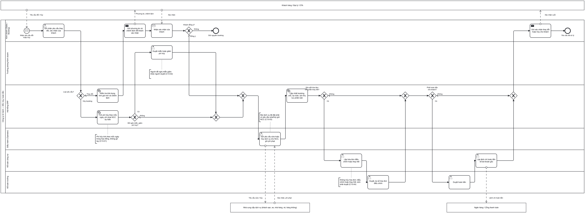

### Hình 2 – Các bên tham gia

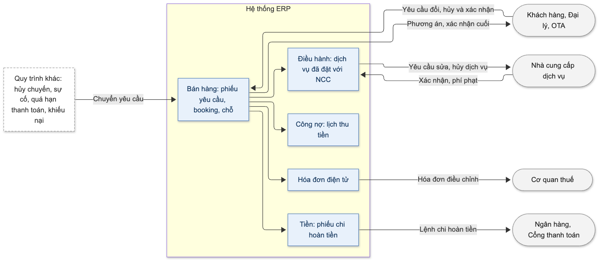

### Hình 3 – Luồng giai đoạn 1 và 2: tiếp nhận đến chốt phương án

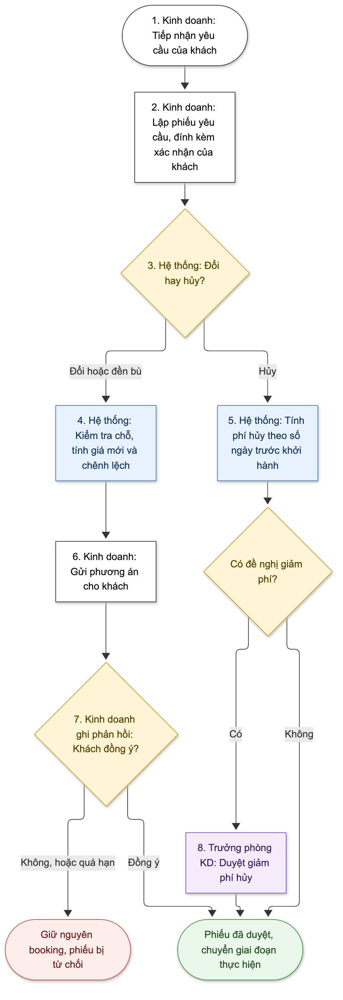

### Hình 4 – Luồng giai đoạn 3 và 4: thực hiện đến kết thúc

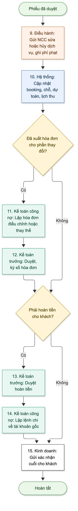

### Hình 5 – Quyết định: tính phí hủy và chọn người duyệt

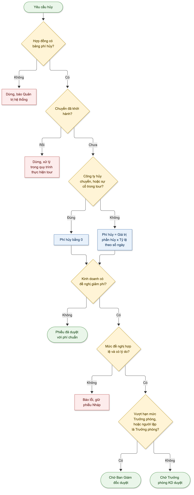

### Hình 6 – Quyết định: xử lý yêu cầu thay đổi

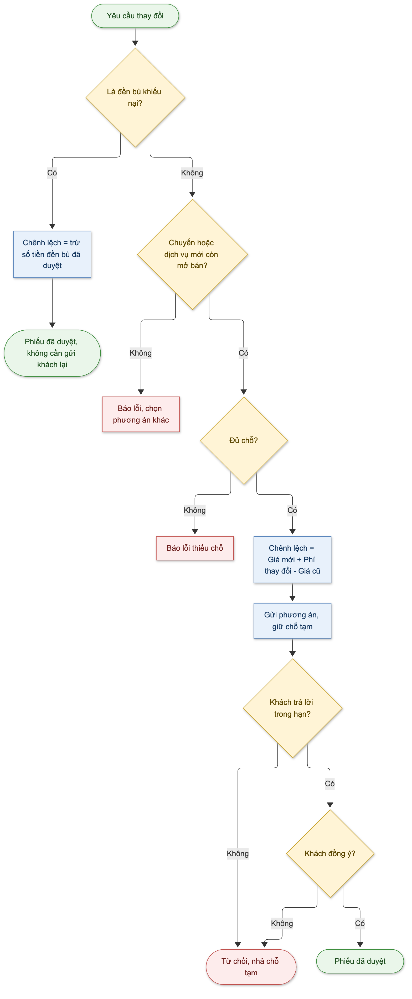

### Hình 7 – Quyết định: hóa đơn và tiền sau khi cập nhật booking

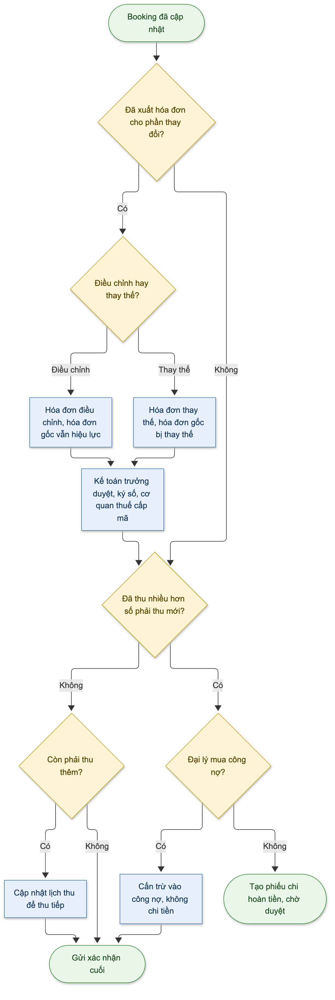

### Hình 8 – Quyết định: duyệt và chi hoàn tiền

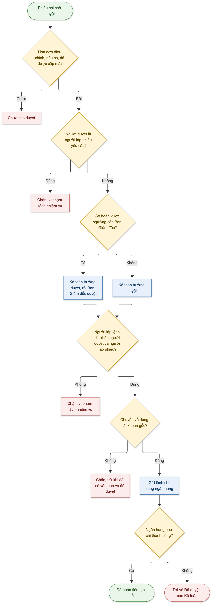

### Hình 9 – Vòng đời phiếu yêu cầu thay đổi

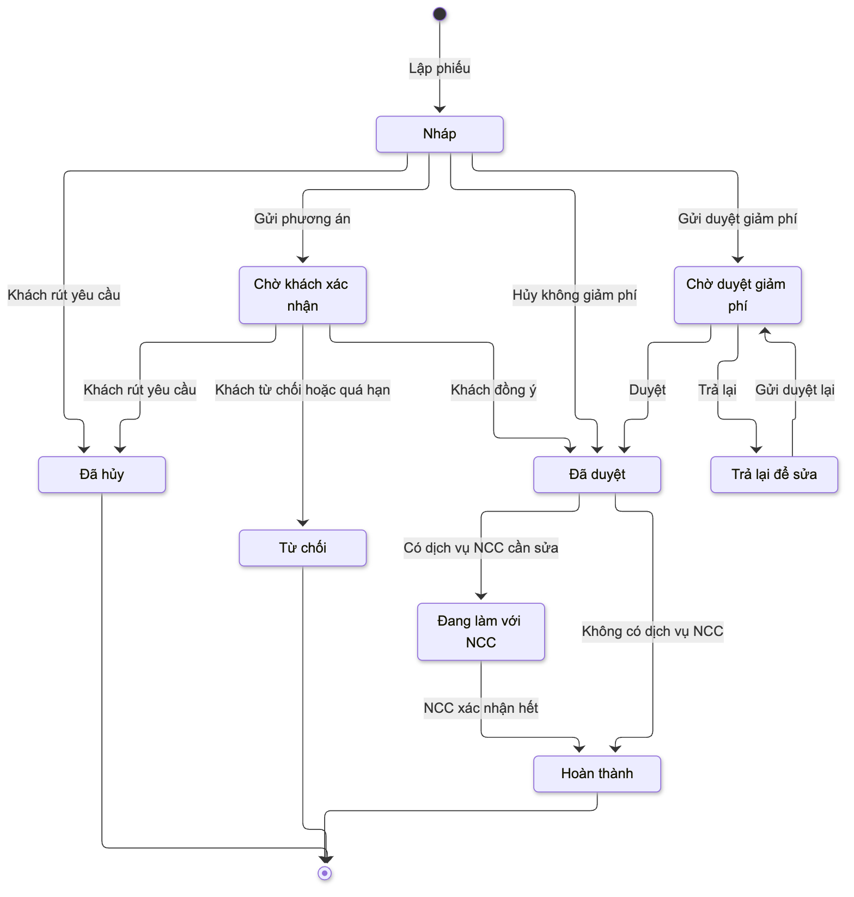

### Hình 10 – Vòng đời hóa đơn điều chỉnh / thay thế

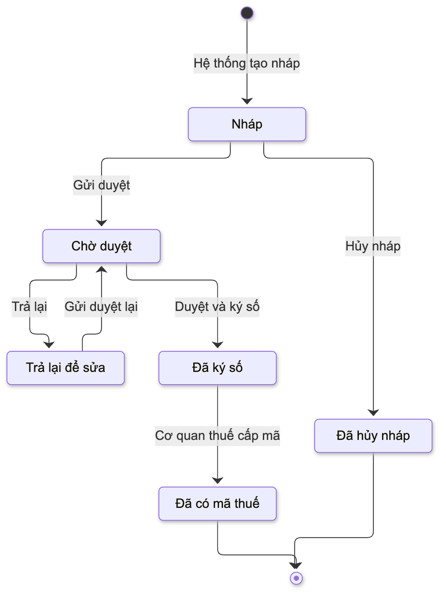

### Hình 11 – Vòng đời phiếu chi hoàn tiền

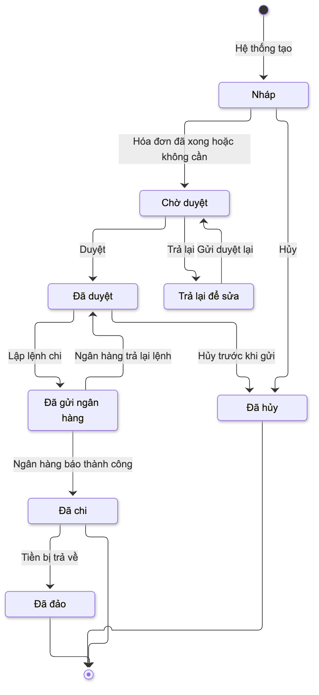

---

## 7. Kiểm soát nội bộ

| Mã | Điểm kiểm soát | Loại | Thực hiện bằng | Căn cứ | Tiêu chí nghiệm thu |
|---|---|---|---|---|---|
| KS-01 | Phí hủy do hệ thống tính theo bảng phí đính kèm hợp đồng; không ai sửa tay | Phòng ngừa, cấu hình | QT-07 đến QT-10; TS-01 đến TS-05 | Elbardan ch07; Wallace ch09 | NT-01, NT-02 |
| KS-02 | Giảm phí ngoài chính sách phải được duyệt; người đề nghị không tự duyệt | Phân quyền | QT-11 đến QT-13; TN-01; TS-10; báo cáo BC-02 | Elbardan ch08 | NT-03, NT-04 |
| KS-03 | Mọi dịch vụ đã đặt của phần bị đổi/hủy đều được báo NCC và có kết quả cuối | Phòng ngừa, báo cáo | QT-19 đến QT-22; báo cáo BC-03, BC-04 | Elbardan ch06; Wallace ch12 | NT-12 |
| KS-04 | Hóa đơn đã có mã chỉ điều chỉnh hoặc thay thế, có thỏa thuận với khách doanh nghiệp, luôn được duyệt | Phòng ngừa, phân quyền | QT-29 đến QT-34; TN-02 | Elbardan ch08; quy định hóa đơn điện tử | NT-13, NT-14 |
| KS-05 | Hoàn về tài khoản gốc; ba người khác nhau lập yêu cầu, duyệt và chi | Phòng ngừa, phân quyền | QT-35 đến QT-43; TN-03 đến TN-06; TS-23 | Elbardan ch07; Elbardan ch02 | NT-15, NT-16, NT-17 |
| KS-06 | Lưu booking trước và sau thay đổi, kèm bằng chứng khách xác nhận | Có sẵn trên hệ thống | QT-02, QT-04, QT-24; báo cáo BC-03 | Wallace ch09; Elbardan ch06 | NT-06, NT-09 |

Các kiểm soát của quy trình khác cũng được thực hiện qua BP-13:

- Hủy hoặc gộp chuyến bắt buộc xử lý khách qua BP-13 (từ BP-07).
- Đổi dịch vụ đã bán trong tour phải có khách xác nhận (từ BP-09).
- Đền bù bằng tiền chỉ qua BP-13 (từ BP-14).

---

## 8. Yêu cầu phi chức năng

Các con số dưới đây là giá trị đề xuất, cần doanh nghiệp xác nhận [Cần xác nhận: CH-26].

| Nhóm | Yêu cầu |
|---|---|
| Lưu vết | Mọi thao tác trên phiếu yêu cầu, yêu cầu gửi NCC, hóa đơn điều chỉnh, phiếu chi, và mọi lần đổi tham số đều được ghi lại: ai, lúc nào, giá trị cũ, giá trị mới, lý do. Không ai sửa hoặc xóa được nhật ký này |
| Nhiều người cùng thao tác | Hai người cùng sửa một phiếu thì người lưu sau được báo và phải tải lại; không có chuyện ghi đè mà không biết |
| Tốc độ | Tính phí hủy, tính chênh lệch, gửi, duyệt: kết quả trong 2 giây. Cập nhật booking ở Bước 10: trong 3 giây. Áp dụng với 100 người dùng cùng lúc |
| Lưu trữ | Phiếu yêu cầu, các phiên bản booking, bằng chứng, hóa đơn điều chỉnh, phiếu chi lưu tối thiểu 10 năm; không xóa trước hạn |
| Bảo vệ dữ liệu cá nhân | Số tài khoản và số giấy tờ tùy thân được mã hóa khi lưu, che khi hiển thị theo mục 4.5, và không xuất hiện trong nhật ký kỹ thuật |
| Chống chi trùng | Gửi lại lệnh chi không tạo khoản chi thứ hai. Hằng ngày đối chiếu với sao kê ngân hàng để phát hiện lệnh treo quá 1 ngày làm việc |
| Kết nối bên ngoài | Gửi thông tin cho khách, NCC, cơ quan thuế: lỗi thì tự gửi lại tối đa 5 lần, sau đó chuyển người xử lý; không thất lạc thông tin |
| Xác thực | Duyệt hoàn tiền, lập lệnh chi, ký số hóa đơn bắt buộc xác thực 2 lớp [Đề xuất: CH-23] |
| Phân quyền | Quyền được kiểm tra ở máy chủ; không thể vượt quyền bằng cách gọi trực tiếp vào hệ thống |
| Giờ và lịch | Tính số ngày và các hạn theo giờ Việt Nam; lịch ngày làm việc và ngày lễ cấu hình được |

---

## 9. Tiêu chí nghiệm thu

Mỗi tiêu chí mô tả theo dạng **Cho trước** (bối cảnh) – **Khi** (thao tác) – **Thì** (kết quả mong đợi), có số liệu cụ thể để kiểm thử.

| Mã | Tình huống | Cho trước | Khi | Thì |
|---|---|---|---|---|
| NT-01 | Tính phí hủy đúng mốc (Ví dụ 1) | Booking 20.000.000 đ, khởi hành 15/12/2026, bảng phí mặc định | Lập phiếu hủy toàn bộ, thời điểm nhận 25/11/2026 10:00 | Số ngày = 20, tỷ lệ 30%, phí chuẩn 6.000.000 đ; không sửa được ô phí |
| NT-02 | Ranh giới giờ chốt | Khởi hành 15/12/2026, giờ chốt 17:00 | Thời điểm nhận 15/11/2026 18:00 | Tính từ 16/11, số ngày = 29, tỷ lệ 30%. Nếu nhận lúc 17:00 thì số ngày = 30, tỷ lệ 10% |
| NT-03 | Người lập không tự duyệt giảm phí | Trưởng phòng A lập phiếu, đề nghị giảm 1.000.000 đ | A bấm Duyệt | Bị chặn với thông báo "Bạn là người tạo yêu cầu… nên không được duyệt"; phiếu chuyển BGĐ duyệt |
| NT-04 | Duyệt giảm phí một phần | Phí chuẩn 6.000.000 đ, đề nghị giảm 3.000.000 đ, trong hạn mức | Trưởng phòng B (không phải người lập) duyệt giảm 2.000.000 đ | Phí khách chịu 4.000.000 đ; phiếu *Đã duyệt*; Điều hành nhận thông báo. Nếu B nhập 3.500.000 đ thì báo lỗi mức giảm không hợp lệ |
| NT-05 | Khách không trả lời đúng hạn | Gửi phương án lúc 01/11/2026 10:00, hạn 48 giờ | Đến 03/11/2026 10:01 chưa có phản hồi | Phiếu *Từ chối*; chỗ tạm được nhả; booking vẫn là phiên bản 1; người lập nhận thông báo |
| NT-06 | Không sửa trực tiếp booking đang có phiếu | Booking có phiếu đang chờ khách xác nhận | Kinh doanh sửa số khách trên booking, hoặc lập thêm phiếu thứ hai | Cả hai bị chặn, hiện liên kết tới phiếu đang xử lý |
| NT-07 | Đổi ngày, giá tăng (Ví dụ 2) | Khách đồng ý chuyển sang chuyến 22/12/2026, giá mới 22.000.000 đ | Hệ thống cập nhật booking | Booking phiên bản 2; nhả 2 chỗ chuyến cũ, giữ 2 chỗ chuyến mới; lịch thu tăng 2.000.000 đ; không có phiếu chi |
| NT-08 | Thiếu chỗ ở chuyến mới | Chuyến mới còn 1 chỗ | Đổi 2 khách sang chuyến đó | Báo "chỉ còn 1 chỗ, phương án cần 2 chỗ"; không gửi được phương án |
| NT-09 | Phạm vi xem và che số tài khoản | Booking X do Kinh doanh A phụ trách; hoàn về tài khoản 0123456789 | Kinh doanh B tìm phiếu của X; A mở phiếu chi | B không thấy phiếu của X; A thấy tài khoản dạng ****6789, không sửa được |
| NT-10 | Hoàn lại khi cập nhật lỗi | Phiếu đang làm với NCC; giả lập lỗi khi cập nhật lịch thu | Hệ thống chạy Bước 10 | Booking, chỗ, dự toán, sổ sách không đổi; phiếu giữ nguyên trạng thái; Kinh doanh và Điều hành được báo |
| NT-11 | Công ty hủy chuyến | Chuyến có 12 booking bị hủy ở BP-07 | BP-07 chuyển sang BP-13 | Hệ thống lập 12 phiếu nháp, phí hủy bằng 0, giao cho Kinh doanh phụ trách từng booking |
| NT-12 | Chờ đủ kết quả từ NCC | Phiếu đã duyệt, có 3 dịch vụ cần báo NCC | 2 dịch vụ đã được NCC xác nhận, 1 dịch vụ chưa | Chưa cập nhật booking. Khi dịch vụ thứ 3 được xác nhận kèm phí phạt 1.200.000 đ và văn bản NCC, hệ thống cập nhật và ghi phải trả NCC 1.200.000 đ. Thiếu văn bản thì không lưu được |
| NT-13 | Khách doanh nghiệp thiếu văn bản thỏa thuận | Nháp hóa đơn điều chỉnh giảm cho khách doanh nghiệp | Kế toán gửi duyệt mà chưa đính kèm văn bản | Bị chặn với thông báo cần văn bản thỏa thuận |
| NT-14 | Trạng thái hóa đơn gốc | Hóa đơn gốc đã có mã | Hóa đơn điều chỉnh được cấp mã; hoặc hóa đơn thay thế được cấp mã | Điều chỉnh: hóa đơn gốc vẫn hiệu lực. Thay thế: hóa đơn gốc bị thay thế và không xử lý tiếp được |
| NT-15 | Hoàn tiền chờ hóa đơn (Ví dụ 3) | Số hoàn 4.000.000 đ; hóa đơn điều chỉnh đang chờ duyệt | Kế toán trưởng mở phiếu chi | Chưa duyệt được. Khi hóa đơn có mã, phiếu chi tự chuyển *Chờ duyệt* và KTT nhận thông báo |
| NT-16 | Ba người khác nhau | A lập phiếu yêu cầu; B (KTT) duyệt hoàn tiền | B, rồi A (giả sử có thêm quyền kế toán) bấm Lập lệnh chi | Cả hai bị chặn. Người dùng C (Kế toán công nợ) lập được |
| NT-17 | Chống chi trùng và ngân hàng trả lại | Phiếu chi đã gửi ngân hàng | Mất kết nối, hệ thống gửi lại; sau đó ngân hàng trả lỗi "tài khoản đã đóng" | Ngân hàng chỉ nhận 1 lệnh. Phiếu chi về *Đã duyệt*, không tự gửi lại; Kế toán được báo; không đổi được tài khoản khi chưa có quyết định cho phép |

**Tình huống biên cần có trong bộ kiểm thử**

| Tình huống | Kết quả mong đợi |
|---|---|
| Hủy đúng ngày khởi hành, trước giờ đi | Tỷ lệ 100% |
| Số ngày rơi đúng ranh giới mốc: 7/8, 14/15, 29/30 | Đúng mức của từng mốc |
| Mức đề nghị giảm đúng bằng hạn mức của Trưởng phòng | Trưởng phòng duyệt, không cần BGĐ |
| Giảm 100% phí | Cho phép; phí khách chịu bằng 0 |
| Tiền cọc ít hơn phí hủy | Không hoàn; phần thiếu đưa vào lịch thu |
| Khách chuyển thêm tiền trong lúc chờ xử lý | Số hoàn tính theo số tiền tại lúc cập nhật |
| Kỳ kế toán đã khóa | Ghi sổ vào kỳ đang mở, có cảnh báo |
| Bảng phí hủy mới có hiệu lực sau ngày ký hợp đồng | Vẫn áp bảng cũ của hợp đồng |
| Người duyệt bị thu hồi quyền khi phiếu đang chờ | Không thao tác được; TPKD chỉ định người khác |
| Hai người cùng trả tiền cho một booking | Hoàn cho từng người, không vượt số mỗi người đã trả |
| Đại lý mua công nợ có số hoàn | Không lập phiếu chi, cấn trừ công nợ |
| Phiếu đã hoàn thành nhưng chưa gửi xác nhận cuối, khách gửi yêu cầu mới | Chưa lập được phiếu mới cho tới khi gửi xác nhận cuối |
| Booking có 30 dịch vụ NCC | Lập đủ 30 dòng; cập nhật xong trong 3 giây |

---

## 10. Câu hỏi cần doanh nghiệp xác nhận

### 10.1 Câu hỏi mở

**Ban Giám đốc**

| Mã | Câu hỏi | Ảnh hưởng |
|---|---|---|
| CH-01 | Dùng một bảng phí hủy cho toàn công ty hay theo loại tour, kênh bán? Hệ thống cũ (topas-crm) đang có hai bộ mốc khác nhau: 4 mốc, và 5 mốc có mức 75%. Tính phí trên giá sau ưu đãi gồm VAT hay giá niêm yết? Ai lập, ai duyệt bảng phí? | TS-01, TS-04; mục 4.3 (e) |
| CH-04 | Hạn mức giảm phí của Trưởng phòng là bao nhiêu (theo % và theo số tiền)? Vượt hạn mức có chuyển Ban Giám đốc không? | TS-10; mục 4.7 |
| CH-12 | Khi công ty hủy chuyến: có bồi thường thêm cho khách không? Hệ thống có tự lập phiếu hàng loạt không? | TS-09 |
| CH-16 | Nhân viên Kinh doanh có được xem giá vốn và phí phạt NCC không? | Mục 4.5 |
| CH-17 | Ngưỡng hoàn tiền phải có Ban Giám đốc duyệt (đề xuất 500 triệu đồng như BP-12)? | TS-22 |
| CH-23 | Có đồng ý các vai trò và cơ chế bổ sung không: Trưởng Điều hành xử lý leo thang; Quản trị hệ thống tách khỏi nghiệp vụ; Kiểm soát nội bộ chỉ xem; ủy quyền duyệt; xác thực 2 lớp? | Mục 4.1, 4.8, 8 |

**Trưởng phòng Kinh doanh**

| Mã | Câu hỏi | Ảnh hưởng |
|---|---|---|
| CH-03 | Đổi tên người đi có thu phí không? Bao nhiêu? | TS-07 |
| CH-06 | Khi hủy, có gửi khách thông báo mức phí trước khi thực hiện không? Nếu giảm phí không được duyệt, khách có được rút yêu cầu hủy không? | Có thể thêm bước gửi phương án cho nhánh hủy |
| CH-07 | Khi đổi booking, có được áp giá ngoài chính sách không? Nếu có, duyệt theo hạn mức ưu đãi như lúc bán? (Sơ đồ BPMN gốc chưa có nhánh này) | QT-15; mục 4.7 |
| CH-08 | Hủy một phần làm khách còn lại bị phụ thu (ví dụ phòng đơn): có bắt buộc khách xác nhận trước không? | QT-18 |
| CH-13 | Đổi chuyến thì giữ ưu đãi cũ hay áp ưu đãi của chuyến mới? | QT-15 |
| CH-14 | Có thu phí thay đổi không? Đổi chuyến khi đã vào mốc có phí thì tính như thay đổi, hay như hủy rồi đặt lại? | TS-07, TS-08 |
| CH-15 | Xác nhận các mốc thời gian đề xuất: khách trả lời trong 48 giờ; giờ chốt 17:00; đếm ngày lịch; độ lệch tối đa 24 giờ; gửi NCC trong 4 giờ làm việc; NCC trả lời trong 24 giờ; cách tạo đợt thu mới; tự lưu thời điểm nhận từ email/OTA | TS-02, 03, 06, 13, 14, 15; QT-26 |
| CH-18 | Có tính riêng chi phí không hoàn (vé máy bay đã xuất, phí visa) ngoài tỷ lệ phí hủy không? | TS-05 |

**Kế toán trưởng**

| Mã | Câu hỏi | Ảnh hưởng |
|---|---|---|
| CH-02 | Phí hủy giữ lại ghi thu nhập khác (711, coi là bồi thường, không chịu VAT) hay doanh thu (511, phải xuất hóa đơn)? | TS-19; mục 3.5; Ví dụ 3 |
| CH-05 | Tiền khách trả trước khởi hành là "đặt cọc bảo đảm hợp đồng" (chưa lập hóa đơn) hay "thu trước tiền dịch vụ" (lập hóa đơn khi thu)? | Mức độ thường xuyên phải lập hóa đơn điều chỉnh |
| CH-09 | Ai lập lệnh chi hoàn tiền: Kế toán công nợ (theo BP-13) hay Kế toán thanh toán / Thủ quỹ (theo BP-12)? | Bước 14; TN-04, TN-05 |
| CH-10 | Công ty áp dụng chế độ kế toán nào? Có dùng tài khoản giảm trừ doanh thu không? | Mục 3.5 |
| CH-11 | Số hoàn cho đại lý mua công nợ: cấn trừ hay chi trả? | TS-20 |
| CH-19 | Booking bằng ngoại tệ: hoàn bằng loại tiền nào, tỷ giá nào, chênh lệch tỷ giá ghi thế nào? | Mục 2.8 |
| CH-20 | Nhiều người cùng trả cho một booking: hoàn cho người trả sau trước có phù hợp không? | QT-36 |
| CH-22 | Có đồng ý bộ trạng thái mở rộng của phiếu chi (thêm Chờ duyệt, Trả lại, Đã gửi ngân hàng, Đã hủy, Đã đảo) không? | Mục 3.3 |
| CH-24 | Có cho phép hoàn sang tài khoản khác tài khoản gốc không? Cần hồ sơ gì? | TS-23 |

**Trưởng Điều hành và Công nghệ thông tin**

| Mã | Câu hỏi | Ảnh hưởng |
|---|---|---|
| CH-21 | NCC từ chối và không tìm được NCC thay thế: ai quyết định, khách được xử lý thế nào? | Mục 2.6 |
| CH-25 | Gửi thông tin cho khách qua kênh nào (email, tin nhắn, cổng OTA), cho NCC qua kênh nào? Có cần đồng bộ trạng thái với hệ thống quản lý kênh OTA không? | Mục 3.6 |
| CH-26 | Xác nhận các chỉ số ở mục 8: tốc độ, số người dùng cùng lúc, số lần gửi lại | Mục 8 |

### 10.2 Giả định đang áp dụng

| Giả định | Nếu sai thì |
|---|---|
| Mỗi booking gắn với đúng một chuyến khởi hành | Phải tính số ngày trước khởi hành theo từng chuyến |
| Mọi dịch vụ đã đặt với NCC đều được ghi nhận ở quy trình đặt dịch vụ (BP-08) | Dịch vụ đặt ngoài hệ thống sẽ bị sót, công ty có thể bị NCC tính tiền |
| Hóa đơn tour là hóa đơn điện tử có mã của cơ quan thuế | Phải đổi quy tắc chọn điều chỉnh hay thay thế |
| Đồng tiền hạch toán là VND | Ảnh hưởng cách so sánh hạn mức duyệt |

### 10.3 Điểm chưa thống nhất giữa các nguồn

| Nội dung | Cách xử lý trong tài liệu này |
|---|---|
| Hệ thống cũ có hai bộ mốc phí hủy khác nhau | Tạm dùng 4 mốc của mô tả quy trình BP-13; chờ CH-01 |
| Có tài liệu tham khảo cho rằng hóa đơn điều chỉnh làm hóa đơn gốc mất hiệu lực | Theo quy định hóa đơn điện tử: chỉ hóa đơn thay thế làm hóa đơn gốc mất hiệu lực; hóa đơn điều chỉnh thì không |
| Có tài liệu tham khảo còn nhắc "hủy hóa đơn" | Theo quy định hiện hành: không hủy hóa đơn đã có mã, chỉ điều chỉnh hoặc thay thế |
| Mô tả quy trình gốc chỉ có 3 trạng thái phiếu chi | Bổ sung theo BP-12; chờ CH-22 |
| BP-13 giao lập lệnh chi cho Kế toán công nợ; BP-12 giao việc chi tiền cho Kế toán thanh toán | Giữ theo BP-13; chờ CH-09 |

---

## 11. Tài liệu tham khảo

**Tài liệu của dự án**

- Mô tả quy trình và sơ đồ BPMN BP-13 "Thay đổi, hủy booking và hoàn tiền". Đây là nguồn chính của tài liệu này.
- Các quy trình liên quan: BP-02, BP-05, BP-06, BP-07, BP-08, BP-09, BP-10, BP-11, BP-12, BP-14.
- Bản đặc tả kỹ thuật BP-13 dành cho đội phát triển: chi tiết dữ liệu, sơ đồ tuần tự, sơ đồ dữ liệu.

**Sách về ERP**

| Sách | Chương | Áp dụng trong tài liệu |
|---|---|---|
| Wallace & Kremzar – *ERP: Making It Happen* | Ch. 4 Software; Ch. 9 Process definition; Ch. 10 Data integrity; Ch. 11, 12, 17 | Thay đổi có chính sách và "vùng thời gian"; ưu tiên tham số hơn sửa chương trình; dữ liệu tiền và chỗ cần kiểm soát chặt; nhắc hạn, xử lý theo ngoại lệ |
| Elbardan & Kholeif – *ERP, Internal Auditing and Corporate Governance* | Ch. 2, 6, 7, 8, 9, 10 | Tách nhiệm vụ, người lập – người duyệt, duyệt theo cấp, kiểm soát phòng ngừa, lưu vết, báo cáo kiểm soát |
| Parthasarathy – *Enterprise Resource Planning* | Ch. 3, 8, 12 | Luồng liên phân hệ; mô hình hóa nghiệp vụ, các bên tham gia, sơ đồ luồng theo vai trò |
| O'Leary – *Enterprise Resource Planning Systems* | Ch. 2, 4, 5 | Cấu hình bằng tham số; kiểm soát dữ liệu đầu vào; báo cáo |

**Quy định pháp luật** (cần kiểm tra lại hiệu lực khi áp dụng)

| Văn bản | Nội dung áp dụng |
|---|---|
| Nghị định 254/2026/NĐ-CP; Thông tư 91/2026/TT-BTC (Điều 10) | Hóa đơn điện tử điều chỉnh, thay thế; văn bản thỏa thuận với người mua |
| Nghị định 181/2025/NĐ-CP | Tiền bồi thường không chịu thuế GTGT (liên quan CH-02) |
| Luật Kế toán 2015 (Điều 13); Nghị định 174/2016/NĐ-CP | Không xóa chứng từ đã ghi sổ; lưu trữ tối thiểu 10 năm |
| Luật Bảo vệ dữ liệu cá nhân số 91/2025/QH15; Nghị định 356/2025/NĐ-CP | Bảo vệ số tài khoản, giấy tờ tùy thân của khách |
